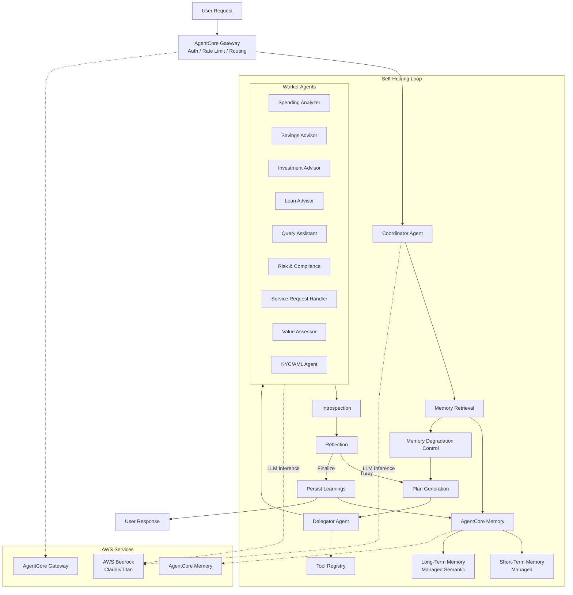
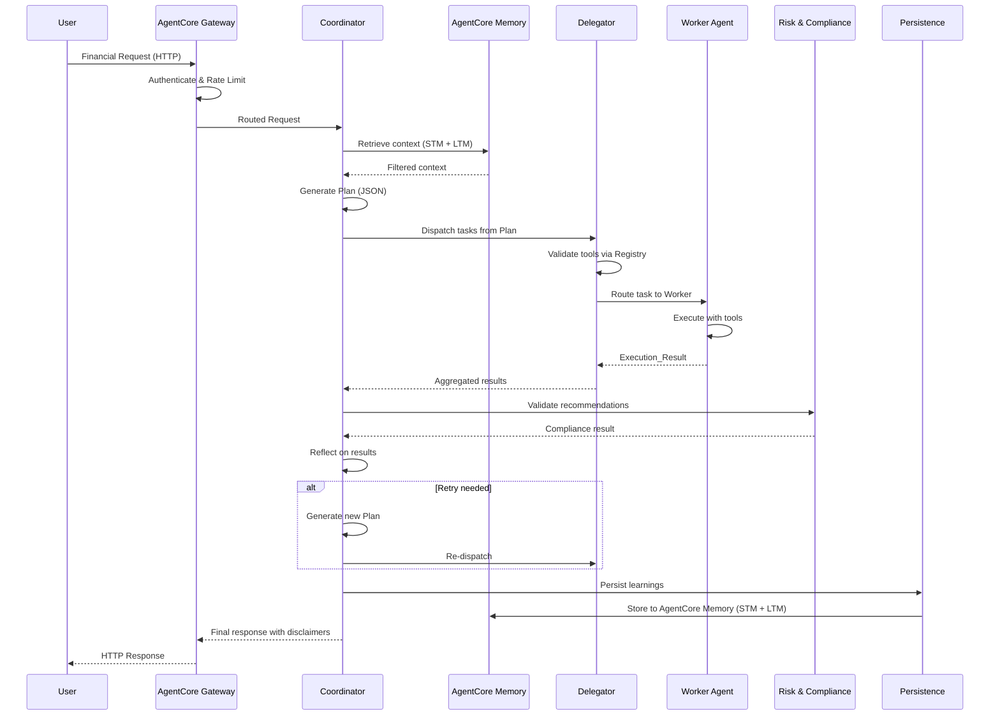

# Design Document: Personal Banker AI Agent

## Overview

The Personal Banker AI Agent is a multi-agent system built on the Strands Agent SDK and deployed via AWS Bedrock AgentCore. It processes user financial requests through a self-healing loop: retrieve memory → plan → delegate → execute → introspect → reflect → retry → persist learnings.

The system uses a three-tier agent hierarchy (Coordinator → Delegator → Workers) with no hardcoded workflows. Each request is dynamically decomposed into tasks, routed to specialist worker agents, and validated for safety and compliance before returning results. External traffic enters through AgentCore Gateway, which provides managed authentication, rate limiting, and routing. A tiered memory system powered by AgentCore Memory (managed short-term and long-term semantic memory) enables continuous learning and context-aware responses without requiring direct management of DynamoDB tables or vector store infrastructure.

The system acts as a single point of contact for all banking needs — from financial advisory to service request handling, loan facilitation, and proactive engagement. It enforces compliance boundaries (non-fiduciary disclosure, loan approval limitations, portfolio management scope), assigns tier-based processing priority, and provides honest value assessments to help users understand when premium services are most beneficial.

The system includes an intelligent KYC/AML agent that autonomously extracts identity information from customer documents, cross-verifies against multiple authoritative sources, reasons over mismatches and conflicts, assigns context-aware risk scores, and makes intelligent escalation decisions with full explainability and audit trails (Reqs 41-50).

The system acts as a single point of contact for all banking needs (Req 28), handling service requests, escalations, complex banking operations (Req 32), and proactive engagement (Req 37). It enforces strict compliance boundaries (Req 34), transparent non-fiduciary disclosures (Req 33), loan approval limitation transparency (Req 35), and portfolio management scope limitations (Req 36). Priority processing is tier-aware (Req 29), loan facilitation applies tier-specific strategies (Req 30), product recommendations are sourced from the bank's Product_Catalog with full disclosure (Req 31), and value assessments help users understand their tier suitability (Req 39). Full service continuity is maintained across sessions via STM+LTM (Req 38).

### Key Design Decisions

1. **Strands Agent SDK as the agent framework**: Provides native tool-use, structured output, and composable agent patterns. Each agent is a Strands `Agent` instance with its own system prompt, tools, and model configuration.
2. **AWS Bedrock for LLM inference**: Claude (Sonnet/Haiku) for reasoning, Titan for embeddings. No self-hosted models.
3. **AgentCore-compatible deployment**: Agents are packaged as AgentCore-compatible runtimes with HTTP endpoints, enabling managed scaling and orchestration.
4. **AgentCore Gateway as the API entry point**: All external traffic enters through AgentCore Gateway, which provides managed HTTP endpoints, authentication, rate limiting, and routing to the agent runtime. This eliminates the need for custom API infrastructure.
5. **AgentCore Memory as the managed memory layer**: Instead of directly managing DynamoDB tables and vector store connections, the system uses AgentCore Memory's built-in short-term and long-term memory services. AgentCore Memory provides managed storage, retrieval, and semantic search — the agents interact through the AgentCore Memory API rather than raw AWS clients.
6. **Dynamic planning over static workflows**: The Coordinator uses LLM reasoning to decompose requests rather than following predefined decision trees.
7. **Memory degradation control**: Only filtered, relevant memory is sent to the LLM — never full history. This preserves context window efficiency and response quality.
8. **Compliance-first output**: Every recommendation passes through the Risk & Compliance agent before reaching the user.
9. **Single point of contact**: The Coordinator acts as the user's virtual relationship manager, handling service requests, escalations, and cross-function coordination without requiring separate customer care contacts.
10. **Non-fiduciary transparency**: All investment and product recommendations carry mandatory disclosures (non-fiduciary disclaimer, Product_Catalog sourcing, commission transparency) to ensure users understand the nature and limitations of advice.
11. **Proactive engagement engine**: The system anticipates user needs based on memory patterns rather than waiting for explicit requests, surfacing opportunities, alerts, and tier-relevant recommendations.
12. **Honest value communication**: The system provides candid value assessments, including recommending basic channels when premium services aren't being utilized.
9. **Single point of contact pattern**: The Coordinator acts as the user's virtual relationship manager, routing service requests, escalations, and complex operations without requiring the user to contact multiple channels.
10. **Non-fiduciary transparency**: All investment and product recommendations carry mandatory disclosures about Product_Catalog sourcing, non-fiduciary status, and commission transparency.
11. **Scope boundary enforcement**: The system explicitly declines out-of-scope requests (active portfolio management, retirement modeling, advanced tax optimization) and directs users to appropriate professionals.
12. **Proactive engagement via memory patterns**: The system uses STM+LTM patterns to proactively surface opportunities and alerts rather than only responding reactively.
13. **Lambda-backed tools**: All 12 financial tools are implemented as individual AWS Lambda functions, registered as targets on AgentCore Gateway. The Gateway exposes them as MCP tools to the agent via OAuth2 authentication. This provides independent scalability, isolated execution, and a clean separation between agent logic and tool implementation. A dual execution path (Lambda vs local stubs) enables seamless development and testing without AWS dependencies.

## Architecture

### High-Level Architecture



### Agent Communication Flow



### Deployment Architecture (AgentCore + Lambda Tools)

The system deploys as a single AgentCore runtime behind AgentCore Gateway. External requests arrive at the Gateway, which handles authentication, rate limiting, and routing before forwarding to the Coordinator agent. Memory operations go through AgentCore Memory's managed APIs. Internal agent communication is in-process (function calls via Strands SDK), not network hops.

All 12 financial tools are deployed as individual AWS Lambda functions and registered as Lambda targets on AgentCore Gateway. The Gateway exposes them as MCP tools accessible via OAuth2. The agent runtime accesses tools through the MCP client within the Strands SDK. Tools are deployed via CloudFormation and registered with the Gateway via `agentcore gateway create-mcp-gateway-target`.

```
AgentCore Gateway (API Entry Point + MCP Tool Gateway)
├── Authentication (OAuth2 via Cognito — auto-provisioned)
├── Rate Limiting & Throttling
├── Request Routing → AgentCore Runtime
├── MCP Tool Endpoint (Lambda targets)
│   ├── smartbanker-transaction_fetcher
│   ├── smartbanker-balance_checker
│   ├── smartbanker-investment_data_api
│   ├── smartbanker-budgeting_calculator
│   ├── smartbanker-service_request_processor
│   ├── smartbanker-escalation_tracker
│   ├── smartbanker-document_guidance_tool
│   ├── smartbanker-loan_product_catalog
│   ├── smartbanker-tier_pricing_engine
│   ├── smartbanker-activity_analyzer
│   ├── smartbanker-tier_benefit_mapper
│   ├── smartbanker-compliance_rule_checker
│   ├── smartbanker-document_extractor
│   ├── smartbanker-identity_verifier
│   ├── smartbanker-sanctions_checker
│   ├── smartbanker-pep_screener
│   └── smartbanker-risk_scorer
└── → AgentCore Runtime
AgentCore Gateway (API Entry Point)
├── Authentication & API Key Management
├── Rate Limiting & Throttling
├── Request Routing
└── → AgentCore Runtime
      ├── Strands Agent: Coordinator
      │   ├── Strands Agent: Delegator
      │   │   ├── Strands Agent: Spending Analyzer
      │   │   ├── Strands Agent: Savings Advisor
      │   │   ├── Strands Agent: Investment Advisor
      │   │   ├── Strands Agent: Loan Advisor
      │   │   ├── Strands Agent: Query Assistant
      │   │   ├── Strands Agent: Risk & Compliance
      │   │   ├── Strands Agent: Service Request Handler
      │   │   ├── Strands Agent: Value Assessor
      │   │   └── Strands Agent: KYC/AML Agent
      │   ├── Proactive Engagement Engine
      │   ├── AgentCore Memory Client
      │   │   ├── Short-Term Memory (managed)
      │   │   └── Long-Term Semantic Memory (managed)
      │   ├── Memory Degradation Control
      │   ├── Disclosure Manager
      │   ├── Priority Manager
      │   ├── Tool Registry
      │   └── Lambda Invoker (tools/lambda_invoker.py)
      │       └── MCP Client → AgentCore Gateway → Lambda Functions
      └── Observability (structured logging)
```


## Components and Interfaces

### 1. Coordinator Agent (`agents/coordinator.py`)

The top-level orchestrator. Receives user requests, manages the self-healing loop, and produces the final response.

```python
from strands import Agent
from strands.models.bedrock import BedrockModel

class CoordinatorAgent:
    """Orchestrates the self-healing loop: memory → plan → delegate → execute → introspect → reflect → retry → persist.
    Acts as the single point of contact for all banking needs including service requests, escalations, and proactive engagement."""
    
    def __init__(self, config: AgentConfig):
        self.model = BedrockModel(model_id=config.llm_model_id, region_name=config.aws_region)
        self.agent = Agent(
            model=self.model,
            system_prompt=COORDINATOR_SYSTEM_PROMPT,
            tools=[self.plan, self.reflect, self.introspect]
        )
        self.delegator = DelegatorAgent(config)
        self.memory = AgentCoreMemoryManager(config)
        self.max_retries = config.max_retries  # default: 3
        self.priority_manager = PriorityManager(config)
        self.disclosure_manager = DisclosureManager()
        self.proactive_engine = ProactiveEngagementEngine(config)
    
    async def process_request(self, user_id: str, request: str) -> FinalResponse:
        """Execute the full self-healing loop for a user request."""
        ...
    
    async def handle_service_request(self, user_id: str, service_request: ServiceRequest) -> FinalResponse:
        """Route service requests to appropriate worker or escalation path. Stores request in STM for continuity."""
        ...
    
    async def escalate(self, user_id: str, service_request: ServiceRequest) -> EscalationResult:
        """Escalate unresolved issues via Service_Escalation workflow. Returns tracking reference and timeline."""
        ...
    
    async def check_proactive_opportunities(self, user_id: str) -> list[ProactiveNotification]:
        """Check for proactive engagement opportunities based on user memory patterns."""
        ...
    
    def plan(self, context: MemoryContext, request: str) -> Plan:
        """Decompose request into structured Plan JSON. Assigns priority based on user tier."""
        ...
    
    def reflect(self, results: list[ExecutionResult]) -> ReflectionDecision:
        """Analyze results for failures, low confidence, risky patterns."""
        ...
    
    def introspect(self, result: ExecutionResult) -> IntrospectionReport:
        """Validate ExecutionResult schema conformance and quality."""
        ...
```

**Interfaces:**
- `process_request(user_id, request) -> FinalResponse`: Entry point for user requests
- `handle_service_request(user_id, service_request) -> FinalResponse`: Routes service requests (Req 28)
- `escalate(user_id, service_request) -> EscalationResult`: Escalates unresolved issues with tracking (Req 28.2, 28.3)
- `check_proactive_opportunities(user_id) -> list[ProactiveNotification]`: Proactive engagement (Req 37)
- `plan(context, request) -> Plan`: Produces structured task decomposition with priority assignment
- `reflect(results) -> ReflectionDecision`: Decides retry vs finalize
- `introspect(result) -> IntrospectionReport`: Validates result quality

### 2. Delegator Agent (`agents/delegator.py`)

Routes tasks to appropriate worker agents after validating tool availability.

```python
class DelegatorAgent:
    """Routes Plan tasks to Worker Agents based on intent matching, tool compatibility, and priority level."""
    
    def __init__(self, config: AgentConfig):
        self.model = BedrockModel(model_id=config.llm_model_id, region_name=config.aws_region)
        self.agent = Agent(
            model=self.model,
            system_prompt=DELEGATOR_SYSTEM_PROMPT,
            tools=[self.route_task]
        )
        self.tool_registry = ToolRegistry()
        self.workers: dict[str, WorkerAgent] = {}  # registered workers
    
    def register_worker(self, domain: str, worker: WorkerAgent) -> None:
        """Register a worker agent for a given domain."""
        ...
    
    async def dispatch(self, plan: Plan, priority_level: str | None = None) -> list[ExecutionResult]:
        """Dispatch all tasks in a Plan to appropriate workers. Respects priority ordering for higher-tier users."""
        ...
    
    def route_task(self, task: PlanTask) -> tuple[WorkerAgent, list[Tool]]:
        """Select best worker and validate tool compatibility."""
        ...
```

**Interfaces:**
- `dispatch(plan, priority_level) -> list[ExecutionResult]`: Executes all tasks in a plan with priority awareness
- `route_task(task) -> (WorkerAgent, list[Tool])`: Selects worker + validates tools
- `register_worker(domain, worker)`: Registers a worker for a domain

### 3. Worker Agents (`agents/workers/`)

Each worker is a Strands Agent with domain-specific tools and system prompt.

```python
class WorkerAgent:
    """Base class for domain-specific worker agents."""
    
    def __init__(self, domain: str, config: AgentConfig, tools: list, system_prompt: str):
        self.domain = domain
        self.model = BedrockModel(model_id=config.llm_model_id, region_name=config.aws_region)
        self.agent = Agent(
            model=self.model,
            system_prompt=system_prompt,
            tools=tools
        )
    
    async def execute(self, task: PlanTask, context: MemoryContext) -> ExecutionResult:
        """Execute a task and return structured ExecutionResult."""
        ...

class SpendingAnalyzerAgent(WorkerAgent):
    """Analyzes transactions and detects spending patterns."""
    # Tools: transaction_fetcher
    
class SavingsAdvisorAgent(WorkerAgent):
    """Suggests personalized saving strategies."""
    # Tools: balance_checker, budgeting_calculator

class InvestmentAdvisorAgent(WorkerAgent):
    """Provides risk-aware investment recommendations."""
    # Tools: investment_data_api

class QueryAssistantAgent(WorkerAgent):
    """Answers financial questions using memory context."""
    # Tools: (memory-based, no external tools)

class RiskComplianceAgent(WorkerAgent):
    """Validates recommendations for safety and compliance. Enforces KYC/credit/compliance rules (Req 34)."""
    # Tools: (validation logic, compliance_rule_checker)

class ServiceRequestHandlerAgent(WorkerAgent):
    """Handles service requests, escalations, and routine banking operations (Req 28, 29, 32)."""
    # Tools: service_request_processor, escalation_tracker, document_guidance_tool
    
    async def handle_service_request(self, request: ServiceRequest, user_tier: str) -> ExecutionResult:
        """Process a service request with tier-based priority assignment."""
        ...
    
    async def escalate(self, request: ServiceRequest) -> EscalationResult:
        """Escalate unresolved issue with tracking reference and estimated timeline."""
        ...

class LoanAdvisorAgent(WorkerAgent):
    """Provides loan advisory with tier-specific facilitation strategies (Req 20, 30, 35)."""
    # Tools: loan_product_catalog, tier_pricing_engine
    
    async def facilitate_loan(self, task: PlanTask, context: MemoryContext) -> ExecutionResult:
        """Facilitate loan application with tier-specific strategies and mandatory disclaimers."""
        ...

class ValueAssessorAgent(WorkerAgent):
    """Analyzes user banking activity against tier benefits for value assessment (Req 39)."""
    # Tools: activity_analyzer, tier_benefit_mapper
    
    async def assess_value(self, user_id: str, tier: str, activity: dict) -> ExecutionResult:
        """Generate value assessment comparing activity against tier benefits."""
        ...
```

**Interface (all workers):**
- `execute(task, context) -> ExecutionResult`: Executes domain task, returns structured result

### 4. Tool Registry (`tools/registry.py`) and Lambda Invoker (`tools/lambda_invoker.py`)

Centralized tool catalog with schema validation. Each tool is backed by an individual AWS Lambda function, invoked via the Lambda Invoker layer.

#### Tool Registry

```python
from dataclasses import dataclass

@dataclass
class ToolSchema:
    name: str
    description: str
    parameters: dict          # JSON Schema for input validation
    compatible_workers: list[str]  # domains that can use this tool

class ToolRegistry:
    """Manages tool catalog and validates invocations against schemas."""
    
    def __init__(self):
        self._tools: dict[str, ToolSchema] = {}
    
    def register(self, schema: ToolSchema) -> None:
        """Register a tool with its schema."""
        ...
    
    def validate_invocation(self, tool_name: str, params: dict) -> ValidationResult:
        """Validate tool invocation parameters against schema."""
        ...
    
    def lookup(self, tool_name: str) -> ToolSchema | None:
        """Look up a tool by name."""
        ...
    
    def get_compatible_tools(self, worker_domain: str) -> list[ToolSchema]:
        """Get all tools compatible with a worker domain."""
        ...
```

#### Lambda Invoker

```python
class LambdaInvoker:
    """Routes tool calls to AWS Lambda functions or local stubs.
    
    Controlled by environment variables:
    - USE_LAMBDA: "true" to invoke Lambda, "false" for local stubs (default)
    - LAMBDA_PREFIX: function name prefix, e.g. "smartbanker" → "smartbanker-transaction_fetcher"
    """
    
    def invoke_tool_lambda(tool_name: str, payload: dict) -> dict:
        """Invoke Lambda function {LAMBDA_PREFIX}-{tool_name} via boto3."""
        ...
    
    def is_lambda_enabled() -> bool:
        """Check if Lambda-backed tools are enabled."""
        ...
```

#### Tool Execution Architecture

Each `@tool` decorated function in `tools/financial_tools.py` uses a dual execution path:
- **Production** (`USE_LAMBDA=true`): Invokes the corresponding Lambda function via `invoke_tool_lambda()`
- **Development/Test** (`USE_LAMBDA=false`): Runs the local stub implementation

```
Worker Agent → @tool function → _invoke_or_local()
                                    ├── Lambda path: boto3.invoke(smartbanker-{tool_name})
                                    └── Local path: inline stub implementation
```

#### Lambda Functions (17 total)

Each tool is deployed as an individual Lambda function and registered as a target on AgentCore Gateway:

| Lambda Function | Gateway Target Name | Compatible Workers |
|---|---|---|
| `smartbanker-transaction_fetcher` | POST /tools/transaction_fetcher | spending_analysis |
| `smartbanker-balance_checker` | POST /tools/balance_checker | savings_advice |
| `smartbanker-investment_data_api` | POST /tools/investment_data_api | investment_advice |
| `smartbanker-budgeting_calculator` | POST /tools/budgeting_calculator | savings_advice |
| `smartbanker-service_request_processor` | POST /tools/service_request_processor | service_request |
| `smartbanker-escalation_tracker` | POST /tools/escalation_tracker | service_request |
| `smartbanker-document_guidance_tool` | POST /tools/document_guidance | service_request |
| `smartbanker-loan_product_catalog` | POST /tools/loan_product_catalog | loan_advice |
| `smartbanker-tier_pricing_engine` | POST /tools/tier_pricing_engine | loan_advice |
| `smartbanker-activity_analyzer` | POST /tools/activity_analyzer | value_assessment |
| `smartbanker-tier_benefit_mapper` | POST /tools/tier_benefit_mapper | value_assessment |
| `smartbanker-compliance_rule_checker` | POST /tools/compliance_rule_checker | risk_compliance |
| `smartbanker-document_extractor` | POST /tools/document_extractor | kyc_aml |
| `smartbanker-identity_verifier` | POST /tools/identity_verifier | kyc_aml |
| `smartbanker-sanctions_checker` | POST /tools/sanctions_checker | kyc_aml |
| `smartbanker-pep_screener` | POST /tools/pep_screener | kyc_aml |
| `smartbanker-risk_scorer` | POST /tools/risk_scorer | kyc_aml |

**Interfaces:**
- `register(schema)`: Add tool to catalog
- `validate_invocation(tool_name, params) -> ValidationResult`: Schema check
- `lookup(tool_name) -> ToolSchema | None`: Find tool by name
- `get_compatible_tools(domain) -> list[ToolSchema]`: Tools for a worker domain
- `invoke_tool_lambda(tool_name, payload) -> dict`: Invoke Lambda-backed tool
- `is_lambda_enabled() -> bool`: Check execution mode

### 5. Memory Layer (AgentCore Memory)

The memory layer uses AgentCore Memory's managed services for both short-term and long-term memory. AgentCore Memory handles the underlying storage infrastructure (DynamoDB, vector stores), so the application interacts through high-level APIs rather than raw AWS clients.

#### AgentCore Memory Manager (`memory/agentcore_memory.py`)

```python
from agentcore.memory import MemoryClient, MemoryNamespace

class AgentCoreMemoryManager:
    """Unified memory manager using AgentCore Memory's managed short-term and long-term memory services."""
    
    def __init__(self, config: MemoryConfig):
        self.client = MemoryClient(
            agent_id=config.agent_id,
            region_name=config.aws_region
        )
        self.stm_namespace = config.stm_namespace  # short-term memory namespace
        self.ltm_namespace = config.ltm_namespace  # long-term semantic memory namespace
        self.max_interactions = config.max_interactions  # default: 20
        self.default_k = config.default_k  # default: 5
    
    async def store_interaction(self, user_id: str, record: InteractionRecord) -> None:
        """Store interaction to short-term memory via AgentCore Memory API. Handles pruning and deduplication."""
        ...
    
    async def retrieve_interactions(self, user_id: str, limit: int | None = None) -> list[InteractionRecord]:
        """Retrieve recent interactions from AgentCore short-term memory."""
        ...
    
    async def get_failures(self, user_id: str, limit: int | None = None) -> list[InteractionRecord]:
        """Retrieve failed interactions from short-term memory, ordered by recency."""
        ...
    
    async def prune(self, user_id: str) -> list[PruneEvent]:
        """Remove oldest non-failure records when exceeding max_interactions."""
        ...
    
    async def deduplicate(self, user_id: str, record: InteractionRecord) -> bool:
        """Check for and remove duplicate entries. Returns True if duplicate found."""
        ...
    
    async def store_pattern(self, pattern: FinancialPattern) -> None:
        """Store financial pattern to long-term semantic memory via AgentCore Memory. Embedding generation is handled by the managed service."""
        ...
    
    async def search_patterns(self, query: str, k: int | None = None) -> list[SimilarPattern]:
        """Semantic similarity search on long-term memory via AgentCore Memory API. Returns top K results."""
        ...
```

#### Memory Degradation Control (`memory/degradation.py`)

```python
class MemoryDegradationControl:
    """Filters memory before sending to LLM to preserve context window efficiency."""
    
    def __init__(self, config: MemoryConfig):
        self.max_failures = config.max_failures_in_context  # from STM
        self.max_patterns = config.max_patterns_in_context  # from LTM
        self.max_age_days = config.max_context_age_days
    
    def prepare_context(
        self, 
        failures: list[InteractionRecord], 
        patterns: list[SimilarPattern],
        current_intent: str
    ) -> MemoryContext:
        """Filter, deduplicate, and assemble relevant memory context."""
        ...
    
    def filter_by_intent(self, records: list, intent: str) -> list:
        """Remove records not relevant to current intent."""
        ...
    
    def remove_duplicates(self, records: list) -> list:
        """Deduplicate failure records."""
        ...
    
    def exclude_outdated(self, records: list) -> list:
        """Remove records older than configured threshold."""
        ...
```

### 6. Observability (`observability/logger.py`)

```python
class CorrelatedLogger:
    """Structured logger with correlation ID for end-to-end request tracing."""
    
    def __init__(self):
        self.logger = structlog.get_logger()
    
    def with_correlation(self, correlation_id: str) -> "CorrelatedLogger":
        """Create a logger bound to a correlation ID."""
        ...
    
    def log_memory_prune(self, user_id: str, record_timestamp: str, reason: str) -> None:
        """Log memory pruning event (Req 14.1)."""
        ...
    
    def log_pattern_reuse(self, pattern_id: str, similarity_score: float) -> None:
        """Log reused financial pattern event (Req 14.2)."""
        ...
    
    def log_avoided_mistake(self, failure_id: str, request_context: str) -> None:
        """Log avoided past mistake event (Req 14.3)."""
        ...
    
    def log_escalation(self, user_id: str, service_request_id: str, tracking_ref: str, estimated_timeline: str) -> None:
        """Log service escalation event (Req 28.3)."""
        ...
    
    def log_priority_assignment(self, user_id: str, task_id: str, priority_level: str, tier: str) -> None:
        """Log priority assignment for tier-based processing (Req 29.3)."""
        ...
    
    def log_compliance_block(self, user_id: str, request_context: str, compliance_rule: str) -> None:
        """Log compliance enforcement event (Req 34.2)."""
        ...
    
    def log_scope_limitation(self, user_id: str, request_context: str, scope_boundary: str) -> None:
        """Log scope limitation response (Req 36.2)."""
        ...
    
    def log_proactive_engagement(self, user_id: str, opportunity_type: str, notification_id: str) -> None:
        """Log proactive engagement notification (Req 37.4)."""
        ...
```

### 7. Proactive Engagement Engine (`engagement/proactive_engine.py`)

Scans user memory patterns and detects opportunities for proactive notifications (Req 37).

```python
class ProactiveEngagementEngine:
    """Detects and surfaces proactive financial opportunities, alerts, and recommendations."""
    
    def __init__(self, config: AgentConfig, memory: AgentCoreMemoryManager):
        self.memory = memory
        self.model = BedrockModel(model_id=config.llm_model_id, region_name=config.aws_region)
    
    async def scan_for_opportunities(self, user_id: str, tier: str) -> list[ProactiveNotification]:
        """Scan user history and patterns for proactive engagement opportunities.
        Returns notifications for fee waiver expiry, investment maturity, tier upgrade eligibility, promotional offers."""
        ...
    
    async def generate_notification(self, opportunity: DetectedOpportunity, user_id: str) -> ProactiveNotification:
        """Generate a user-facing proactive notification from a detected opportunity."""
        ...
    
    def detect_patterns(self, interactions: list[InteractionRecord], patterns: list[SimilarPattern]) -> list[DetectedOpportunity]:
        """Analyze STM+LTM data to detect actionable opportunities."""
        ...
```

**Interfaces:**
- `scan_for_opportunities(user_id, tier) -> list[ProactiveNotification]`: Main entry point for proactive scanning
- `generate_notification(opportunity, user_id) -> ProactiveNotification`: Converts opportunity to notification
- `detect_patterns(interactions, patterns) -> list[DetectedOpportunity]`: Pattern detection logic

### 8. Disclosure Manager (`compliance/disclosure_manager.py`)

Centralizes all mandatory disclosures, disclaimers, and transparency notes across the system (Reqs 31, 33, 35, 36).

```python
class DisclosureManager:
    """Attaches mandatory disclosures and disclaimers to ExecutionResults based on domain and content type."""
    
    NON_FIDUCIARY_DISCLAIMER = (
        "This system does not act as a fiduciary advisor and does not always act in your best financial interest. "
        "Recommended products may carry associated commissions or incentives for the banking institution."
    )
    PRODUCT_CATALOG_DISCLOSURE = (
        "Recommendations are sourced from the bank's Product Catalog and do not represent the full market. "
        "This system is not an independent financial advisor."
    )
    LOAN_APPROVAL_DISCLAIMER = (
        "Facilitation improves chances but does not guarantee approval. Final approval depends on credit score, "
        "income verification, and risk assessment by the lending institution."
    )
    VERIFICATION_REMINDER = "Please independently verify all investment recommendations before making financial decisions."
    
    def apply_disclosures(self, result: ExecutionResult, worker_domain: str) -> ExecutionResult:
        """Apply all applicable disclosures to an ExecutionResult based on worker domain."""
        ...
    
    def attach_non_fiduciary(self, result: ExecutionResult) -> ExecutionResult:
        """Attach non-fiduciary disclaimer to investment/product advice results (Req 33)."""
        ...
    
    def attach_product_catalog_disclosure(self, result: ExecutionResult) -> ExecutionResult:
        """Attach Product_Catalog sourcing disclosure to product recommendations (Req 31)."""
        ...
    
    def attach_loan_disclaimer(self, result: ExecutionResult) -> ExecutionResult:
        """Attach loan approval limitation disclaimer (Req 35)."""
        ...
    
    def attach_scope_limitation(self, result: ExecutionResult, request_context: str) -> ExecutionResult:
        """Attach scope limitation notice for out-of-scope requests (Req 36)."""
        ...
    
    def attach_commission_disclosure(self, result: ExecutionResult) -> ExecutionResult:
        """Attach commission/incentive transparency note (Req 33.2)."""
        ...
```

**Interfaces:**
- `apply_disclosures(result, worker_domain) -> ExecutionResult`: Main entry point — applies all relevant disclosures
- `attach_non_fiduciary(result) -> ExecutionResult`: Non-fiduciary disclaimer for investment advice
- `attach_product_catalog_disclosure(result) -> ExecutionResult`: Product catalog sourcing disclosure
- `attach_loan_disclaimer(result) -> ExecutionResult`: Loan approval limitation disclaimer
- `attach_scope_limitation(result, request_context) -> ExecutionResult`: Scope limitation for out-of-scope requests
- `attach_commission_disclosure(result) -> ExecutionResult`: Commission transparency note

### 9. Priority Manager (`priority/priority_manager.py`)

Manages tier-based priority assignment for banking tasks (Req 29).

```python
class PriorityManager:
    """Assigns processing priority based on user Programme_Tier and manages priority metadata."""
    
    def __init__(self, config: PriorityConfig):
        self.tier_priority_map = config.tier_priority_map
        self.estimated_times = config.estimated_processing_times
    
    def assign_priority(self, user_tier: str) -> str:
        """Map user Programme_Tier to processing priority level."""
        ...
    
    def get_estimated_time(self, priority_level: str) -> str:
        """Get estimated processing time for a priority level."""
        ...
    
    def enrich_result(self, result: ExecutionResult, user_tier: str) -> ExecutionResult:
        """Add priority_level and estimated_processing_time to an ExecutionResult."""
        ...
    
    def validate_priority_ordering(self, tier_a: str, tier_b: str) -> bool:
        """Verify that a higher tier maps to equal or higher priority than a lower tier."""
        ...
```

**Interfaces:**
- `assign_priority(user_tier) -> str`: Maps tier to priority level
- `get_estimated_time(priority_level) -> str`: Gets estimated processing time
- `enrich_result(result, user_tier) -> ExecutionResult`: Adds priority metadata to result
- `validate_priority_ordering(tier_a, tier_b) -> bool`: Validates tier ordering invariant

### 10. Configuration (`config/settings.py`)

```python
from pydantic import BaseModel

class AgentConfig(BaseModel):
    aws_region: str = "us-east-1"
    llm_model_id: str = "anthropic.claude-sonnet-4-20250514"
    embedding_model_id: str = "amazon.titan-embed-text-v2:0"
    max_retries: int = 3

class GatewayConfig(BaseModel):
    gateway_id: str                     # AgentCore Gateway identifier
    stage: str = "prod"                 # Gateway deployment stage
    auth_type: str = "iam"              # "iam", "api_key", or "cognito"
    rate_limit_rps: int = 100           # Requests per second limit
    burst_limit: int = 200              # Burst request limit

class MemoryConfig(BaseModel):
    agent_id: str                       # AgentCore agent identifier for memory scoping
    aws_region: str = "us-east-1"
    stm_namespace: str = "short-term"   # AgentCore Memory namespace for short-term memory
    ltm_namespace: str = "long-term"    # AgentCore Memory namespace for long-term semantic memory
    max_interactions: int = 20
    max_failures_in_context: int = 10
    max_patterns_in_context: int = 5
    max_context_age_days: int = 90
    default_k: int = 5

class PriorityConfig(BaseModel):
    """Tier-to-priority mapping for banking task processing (Req 29)."""
    tier_priority_map: dict[str, str] = {
        "basic": "standard",
        "preferred": "elevated",
        "premium": "high",
        "ultra-premium": "critical"
    }
    estimated_processing_times: dict[str, str] = {
        "standard": "3-5 business days",
        "elevated": "1-3 business days",
        "high": "same business day",
        "critical": "within 4 hours"
    }

class ComplianceConfig(BaseModel):
    """Compliance rules that cannot be bypassed (Req 34)."""
    mandatory_checks: list[str] = ["kyc_verification", "credit_check", "aml_screening", "sanctions_check"]
    non_waivable_rules: list[str] = ["kyc", "credit_assessment", "regulatory_compliance"]

class ScopeLimitationConfig(BaseModel):
    """Out-of-scope service definitions (Req 36)."""
    out_of_scope_services: list[str] = [
        "active_portfolio_management",
        "daily_wealth_monitoring",
        "retirement_modeling",
        "advanced_tax_optimization"
    ]
```

### 11. AgentCore Entry Point (`main.py`)

The application is deployed behind AgentCore Gateway, which handles authentication, rate limiting, and routing. The runtime handler receives pre-authenticated, routed requests from the Gateway.

```python
from strands import Agent
from agents.coordinator import CoordinatorAgent

def create_app(config: AppConfig) -> CoordinatorAgent:
    """Create and configure the agent application for AgentCore deployment."""
    coordinator = CoordinatorAgent(config.agent)
    # Register all workers with delegator
    coordinator.delegator.register_worker("spending_analysis", SpendingAnalyzerAgent(config.agent))
    coordinator.delegator.register_worker("savings_advice", SavingsAdvisorAgent(config.agent))
    coordinator.delegator.register_worker("investment_advice", InvestmentAdvisorAgent(config.agent))
    coordinator.delegator.register_worker("loan_advice", LoanAdvisorAgent(config.agent))
    coordinator.delegator.register_worker("financial_query", QueryAssistantAgent(config.agent))
    coordinator.delegator.register_worker("risk_compliance", RiskComplianceAgent(config.agent))
    coordinator.delegator.register_worker("service_request", ServiceRequestHandlerAgent(config.agent))
    coordinator.delegator.register_worker("value_assessment", ValueAssessorAgent(config.agent))
    coordinator.delegator.register_worker("kyc_aml", KYCAgent(config.agent))
    # Initialize proactive engagement engine
    coordinator.proactive_engine = ProactiveEngagementEngine(config.agent, coordinator.memory)
    return coordinator

# AgentCore-compatible HTTP handler (invoked by AgentCore Gateway)
async def handler(event: dict) -> dict:
    """AgentCore runtime entry point. Receives pre-authenticated requests from AgentCore Gateway."""
    app = create_app(load_config())
    user_id = event["user_id"]
    request = event["request"]
    response = await app.process_request(user_id, request)
    return response.to_dict()
```

### 13. KYC/AML Agent (`agents/workers/kyc_aml_agent.py`)

Intelligent KYC/AML agent that reasons about identity verification rather than following a fixed pipeline. Implements the 5-step flow: Extract → Verify → Reason → Assess → Decide.

```python
class KYCAgent(WorkerAgent):
    """Intelligent KYC/AML agent with reasoning capabilities.
    
    Unlike a pipeline (Extract → Verify → Flag), this agent reasons:
    "I found a mismatch; let me check two more sources before deciding..."
    
    Traces: R41, R42, R43, R44, R45.
    """
    
    def __init__(self, config: AgentConfig):
        super().__init__(domain="kyc_aml", config=config, tools=[
            document_extractor, identity_verifier, sanctions_checker,
            pep_screener, risk_scorer,
        ], system_prompt=KYC_SYSTEM_PROMPT)
    
    def extract_document(self, document: bytes, doc_format: str) -> KYCExtractionResult:
        """Step 1: Intelligent document understanding via OCR + LLM reasoning."""
        ...
    
    def verify_identity(self, extraction: KYCExtractionResult) -> VerificationSummary:
        """Step 2: Multi-source verification orchestration (parallel where possible)."""
        ...
    
    def resolve_conflicts(self, summary: VerificationSummary) -> ConflictResolutionReport:
        """Step 3: Intelligent conflict resolution with reasoning chain."""
        ...
    
    def assess_risk(self, extraction: KYCExtractionResult, summary: VerificationSummary,
                    conflicts: ConflictResolutionReport, user_context: dict) -> RiskAssessment:
        """Step 4: Context-aware risk scoring."""
        ...
    
    def decide_escalation(self, assessment: RiskAssessment) -> EscalationDecision:
        """Step 5: Smart escalation with full explainability."""
        ...
    
    def run_full_kyc(self, document: bytes, user_id: str) -> ExecutionResult:
        """Run the complete KYC/AML assessment with agent reasoning."""
        ...
```

**Interfaces:**
- `extract_document(document, doc_format) -> KYCExtractionResult`: OCR + LLM extraction
- `verify_identity(extraction) -> VerificationSummary`: Multi-source parallel verification
- `resolve_conflicts(summary) -> ConflictResolutionReport`: Intelligent reasoning about mismatches
- `assess_risk(...) -> RiskAssessment`: Context-aware composite risk scoring
- `decide_escalation(assessment) -> EscalationDecision`: Smart escalation with explainability
- `run_full_kyc(document, user_id) -> ExecutionResult`: End-to-end KYC assessment

## Data Models

### 12. Streamlit UI (`ui/app.py`)

A locally-run Streamlit web application that provides a rich chat interface for interacting with the AWS-deployed agent backend. Supports both remote (AgentCore Gateway) and local (in-process) execution modes.

```python
import streamlit as st
import requests
from main import create_app

class SmartBankerUI:
    """Streamlit-based UI for the Personal Banker AI Agent.
    
    Modes:
    - Remote: Sends requests to AgentCore Gateway endpoint via HTTP POST
    - Local: Invokes the agent directly in-process (no AWS required)
    """
    
    def render_chat(): ...          # Chat input + message history
    def render_recommendation(r): ... # Structured recommendation card
    def render_sidebar(): ...       # Config: endpoint URL, user ID, region, mode
    def render_notifications(): ... # Proactive engagement notifications panel
    def render_service_request(): ... # Service request submission form
    def call_agent(request): ...    # Route to remote or local based on mode
```

**Interfaces:**
- Chat interface with conversation history
- Structured recommendation cards (status, confidence, risk, disclaimers)
- Sidebar configuration (endpoint, user ID, region, mode toggle)
- Proactive notifications panel
- Service request submission form
- Color-coded status indicators (success=green, partial=yellow, failure=red)

**Execution modes:**
- `Remote`: HTTP POST to `{gateway_url}/invoke` with `{"user_id": ..., "request": ...}`
- `Local`: Direct call to `create_app().process_request(user_id, request)`

### Plan Schema

```json
{
  "type": "object",
  "required": ["plan_id", "user_id", "tasks", "created_at"],
  "properties": {
    "plan_id": { "type": "string", "format": "uuid" },
    "user_id": { "type": "string" },
    "original_request": { "type": "string" },
    "tasks": {
      "type": "array",
      "items": {
        "type": "object",
        "required": ["task_id", "intent", "assigned_worker", "execution_order"],
        "properties": {
          "task_id": { "type": "string", "format": "uuid" },
          "intent": { "type": "string" },
          "assigned_worker": { "type": "string", "enum": ["spending_analysis", "savings_advice", "investment_advice", "loan_advice", "financial_query", "risk_compliance", "service_request", "value_assessment", "kyc_aml"] },
          "execution_order": { "type": "integer", "minimum": 0 },
          "required_tools": { "type": "array", "items": { "type": "string" } },
          "context_hints": { "type": "string" }
        }
      }
    },
    "excluded_strategies": {
      "type": "array",
      "items": { "type": "string" },
      "description": "Previously failed strategies to avoid"
    },
    "created_at": { "type": "string", "format": "date-time" }
  }
}
```

### Execution Result Schema

```json
{
  "type": "object",
  "required": ["status", "confidence", "recommendation", "risk_level", "issues"],
  "properties": {
    "status": { "type": "string", "enum": ["success", "failure"] },
    "confidence": { "type": "string", "enum": ["high", "medium", "low"] },
    "recommendation": { "type": "string" },
    "risk_level": { "type": "string", "enum": ["low", "medium", "high"] },
    "issues": { "type": "array", "items": { "type": "string" } },
    "explainability_summary": { "type": "string" },
    "disclaimer": { "type": "string" },
    "worker_domain": { "type": "string" },
    "task_id": { "type": "string", "format": "uuid" },
    "recommendation_source": {
      "type": "string",
      "enum": ["product_catalog", "general_market_data", "user_specific_analysis"],
      "description": "Source of the recommendation (Req 31.2)"
    },
    "non_fiduciary_disclaimer": {
      "type": "string",
      "description": "Mandatory non-fiduciary disclosure for investment/product advice (Req 33.4)"
    },
    "scope_limitation": {
      "type": "string",
      "description": "Scope limitation notice when request touches out-of-scope services (Req 36.4)"
    },
    "facilitation_summary": {
      "type": "string",
      "description": "Description of facilitation actions taken for loan requests (Req 30.2)"
    },
    "priority_level": {
      "type": "string",
      "enum": ["standard", "elevated", "high", "critical"],
      "description": "Tier-based processing priority (Req 29.1)"
    },
    "estimated_processing_time": {
      "type": "string",
      "description": "Estimated processing time based on priority level (Req 29.4)"
    },
    "tracking_reference": {
      "type": "string",
      "description": "User-visible tracking reference for service requests/escalations (Req 28.2)"
    },
    "commission_disclosure": {
      "type": "string",
      "description": "Transparency note about commissions or incentives (Req 33.2)"
    }
  }
}
```

### Interaction Record (DynamoDB)

```json
{
  "type": "object",
  "required": ["user_id", "timestamp", "input", "output", "status", "confidence"],
  "properties": {
    "user_id": { "type": "string", "description": "Partition key" },
    "timestamp": { "type": "string", "format": "date-time", "description": "Sort key" },
    "input": { "type": "string", "description": "User request text" },
    "output": { "type": "string", "description": "Agent response summary" },
    "status": { "type": "string", "enum": ["success", "failure"] },
    "confidence": { "type": "string", "enum": ["high", "medium", "low"] },
    "intent": { "type": "string" },
    "worker_domain": { "type": "string" },
    "strategy_used": { "type": "string" },
    "correlation_id": { "type": "string", "format": "uuid" },
    "channel_id": { "type": "string", "description": "Channel identifier for multi-channel support (Req 26.3)" },
    "priority_level": { "type": "string", "enum": ["standard", "elevated", "high", "critical"], "description": "Tier-based processing priority (Req 29.3)" },
    "service_request_type": { "type": "string", "description": "Type of service request if applicable (Req 28.4)" }
  }
}
```

**Storage:** Managed by AgentCore Memory (short-term namespace). The underlying DynamoDB table structure is handled by the service. The application interacts through the AgentCore Memory API using `user_id` as the scoping key and `timestamp` for ordering.

### Financial Pattern (AgentCore Long-Term Memory)

```json
{
  "type": "object",
  "required": ["pattern_id", "user_id", "pattern_type", "content", "embedding", "created_at"],
  "properties": {
    "pattern_id": { "type": "string", "format": "uuid" },
    "user_id": { "type": "string" },
    "pattern_type": { "type": "string", "enum": ["behavior", "recommendation", "failure", "preference"] },
    "content": { "type": "string", "description": "Text content used to generate embedding" },
    "embedding": { "type": "array", "items": { "type": "number" }, "description": "Vector embedding (generated by AgentCore Memory service)" },
    "metadata": {
      "type": "object",
      "properties": {
        "risk_level": { "type": "string" },
        "confidence": { "type": "string" },
        "worker_domain": { "type": "string" },
        "outcome": { "type": "string", "enum": ["success", "failure"] }
      }
    },
    "created_at": { "type": "string", "format": "date-time" }
  }
}
```

### Final Response Schema

```json
{
  "type": "object",
  "required": ["correlation_id", "user_id", "recommendations", "status"],
  "properties": {
    "correlation_id": { "type": "string", "format": "uuid" },
    "user_id": { "type": "string" },
    "status": { "type": "string", "enum": ["success", "partial_success", "failure"] },
    "recommendations": {
      "type": "array",
      "items": {
        "type": "object",
        "required": ["recommendation", "risk_level", "confidence"],
        "properties": {
          "recommendation": { "type": "string" },
          "risk_level": { "type": "string", "enum": ["low", "medium", "high"] },
          "confidence": { "type": "string", "enum": ["high", "medium", "low"] },
          "explainability_summary": { "type": "string" },
          "disclaimer": { "type": "string" },
          "low_confidence_warning": { "type": "string" },
          "worker_domain": { "type": "string" }
        }
      }
    },
    "retries_used": { "type": "integer" },
    "warnings": { "type": "array", "items": { "type": "string" } }
  }
}
```

### Validation Result Schema

```json
{
  "type": "object",
  "required": ["valid", "errors"],
  "properties": {
    "valid": { "type": "boolean" },
    "errors": { "type": "array", "items": { "type": "string" } }
  }
}
```

### Tool Schema Definition

```json
{
  "type": "object",
  "required": ["name", "description", "parameters", "compatible_workers"],
  "properties": {
    "name": { "type": "string" },
    "description": { "type": "string" },
    "parameters": { "type": "object", "description": "JSON Schema for tool input validation" },
    "compatible_workers": { "type": "array", "items": { "type": "string" } }
  }
}
```

### Registered Tools

| Tool Name | Compatible Workers | Description |
|---|---|---|
| `transaction_fetcher` | spending_analysis | Retrieves user transaction data |
| `balance_checker` | savings_advice | Checks current account balances |
| `budgeting_calculator` | savings_advice | Calculates budget allocations |
| `investment_data_api` | investment_advice | Retrieves market/investment data |
| `service_request_processor` | service_request | Processes service requests and routes to resolution |
| `escalation_tracker` | service_request | Tracks escalation status and generates tracking references |
| `document_guidance_tool` | service_request | Identifies required documents for complex operations |
| `loan_product_catalog` | loan_advice | Retrieves loan products with tier-specific pricing |
| `tier_pricing_engine` | loan_advice | Calculates tier-specific preferential terms |
| `activity_analyzer` | value_assessment | Analyzes user banking activity metrics |
| `tier_benefit_mapper` | value_assessment | Maps tier benefits to user activity for value assessment |
| `compliance_rule_checker` | risk_compliance | Validates requests against mandatory compliance rules |
| `document_extractor` | kyc_aml | OCR + LLM extraction from identity documents (PAN, Passport, DL, Aadhaar) |
| `identity_verifier` | kyc_aml | Cross-verifies extracted identity data against government databases and internal records |
| `sanctions_checker` | kyc_aml | Checks customer against global sanctions lists (OFAC, UN, EU) |
| `pep_screener` | kyc_aml | Screens customer against Politically Exposed Persons databases |
| `risk_scorer` | kyc_aml | Computes composite risk score from extraction, verification, and context factors |

### Service Request Schema

```json
{
  "type": "object",
  "required": ["request_id", "user_id", "request_type", "description", "status", "created_at"],
  "properties": {
    "request_id": { "type": "string", "format": "uuid" },
    "user_id": { "type": "string" },
    "request_type": {
      "type": "string",
      "enum": ["account_modification", "charge_dispute", "failed_transaction_inquiry", "service_modification", "card_issue", "document_request", "kyc_update", "cheque_book_request", "other"]
    },
    "description": { "type": "string" },
    "status": {
      "type": "string",
      "enum": ["received", "in_progress", "escalated", "resolved", "closed"]
    },
    "priority_level": {
      "type": "string",
      "enum": ["standard", "elevated", "high", "critical"]
    },
    "tracking_reference": { "type": "string" },
    "escalation": {
      "type": "object",
      "properties": {
        "escalated_at": { "type": "string", "format": "date-time" },
        "escalation_reason": { "type": "string" },
        "estimated_resolution_timeline": { "type": "string" },
        "escalation_path": { "type": "string" }
      }
    },
    "created_at": { "type": "string", "format": "date-time" },
    "updated_at": { "type": "string", "format": "date-time" }
  }
}
```

### Value Assessment Result Schema

```json
{
  "type": "object",
  "required": ["user_id", "current_tier", "activity_summary", "utilized_benefits", "unused_benefits", "value_score"],
  "properties": {
    "user_id": { "type": "string" },
    "current_tier": { "type": "string" },
    "activity_summary": {
      "type": "object",
      "properties": {
        "average_balance": { "type": "number" },
        "loan_usage": { "type": "boolean" },
        "investment_activity": { "type": "boolean" },
        "service_request_frequency": { "type": "integer" },
        "transaction_volume": { "type": "integer" }
      }
    },
    "utilized_benefits": {
      "type": "array",
      "items": { "type": "string" },
      "description": "List of tier benefits the user is actively using"
    },
    "unused_benefits": {
      "type": "array",
      "items": { "type": "string" },
      "description": "List of tier benefits the user is not utilizing"
    },
    "value_score": {
      "type": "number",
      "minimum": 0,
      "maximum": 1,
      "description": "Ratio of utilized benefits to total available benefits"
    },
    "tier_recommendation": {
      "type": "object",
      "properties": {
        "recommended_tier": { "type": "string" },
        "direction": { "type": "string", "enum": ["upgrade", "downgrade", "maintain"] },
        "rationale": { "type": "string" }
      }
    },
    "self_service_sufficient": {
      "type": "boolean",
      "description": "Whether basic self-service channels would be sufficient for the user (Req 39.4)"
    }
  }
}
```

### Proactive Notification Schema

```json
{
  "type": "object",
  "required": ["notification_id", "user_id", "opportunity_type", "message", "created_at"],
  "properties": {
    "notification_id": { "type": "string", "format": "uuid" },
    "user_id": { "type": "string" },
    "opportunity_type": {
      "type": "string",
      "enum": ["fee_waiver_expiry", "investment_maturity", "tier_upgrade_eligibility", "promotional_offer", "tier_downgrade_risk", "savings_opportunity"]
    },
    "message": { "type": "string" },
    "priority": { "type": "string", "enum": ["low", "medium", "high"] },
    "tier_specific": { "type": "boolean", "description": "Whether the opportunity content varies by tier" },
    "created_at": { "type": "string", "format": "date-time" }
  }
}
```

### Priority Level Mapping

| Programme Tier | Priority Level | Estimated Processing Time |
|---|---|---|
| basic | standard | 3-5 business days |
| preferred | elevated | 1-3 business days |
| premium | high | Same business day |
| ultra-premium | critical | Within 4 hours |

### KYC/AML Data Models

#### KYCExtractionResult Schema

```json
{
  "type": "object",
  "required": ["extraction_id", "document_type", "extracted_fields", "overall_confidence", "document_integrity"],
  "properties": {
    "extraction_id": { "type": "string", "format": "uuid" },
    "document_type": { "type": "string", "enum": ["pan", "passport", "driving_license", "aadhaar"] },
    "document_format": { "type": "string", "enum": ["jpeg", "png", "pdf", "tiff"] },
    "extracted_fields": {
      "type": "object",
      "properties": {
        "full_name": { "$ref": "#/$defs/ExtractedField" },
        "date_of_birth": { "$ref": "#/$defs/ExtractedField" },
        "document_number": { "$ref": "#/$defs/ExtractedField" },
        "address": { "$ref": "#/$defs/ExtractedField" },
        "expiry_date": { "$ref": "#/$defs/ExtractedField" },
        "issuing_authority": { "$ref": "#/$defs/ExtractedField" }
      }
    },
    "overall_confidence": { "type": "number", "minimum": 0.0, "maximum": 1.0 },
    "document_integrity": {
      "type": "object",
      "properties": {
        "is_blurry": { "type": "boolean" },
        "is_partial_scan": { "type": "boolean" },
        "is_photocopy": { "type": "boolean" },
        "is_tampered": { "type": "boolean" },
        "is_expired": { "type": "boolean" }
      }
    },
    "low_confidence_fields": {
      "type": "array",
      "items": { "type": "string" },
      "description": "Fields with confidence below threshold (default 0.8), flagged for manual review"
    },
    "format_validation_failures": {
      "type": "array",
      "items": { "type": "string" },
      "description": "Fields that failed document structure rules (e.g., PAN format ABCDE1234F)"
    },
    "source_attribution": {
      "type": "object",
      "properties": {
        "document_type": { "type": "string" },
        "extraction_method": { "type": "string", "enum": ["textract_ocr", "llm_reasoning", "hybrid"] }
      }
    }
  },
  "$defs": {
    "ExtractedField": {
      "type": "object",
      "required": ["value", "confidence", "source"],
      "properties": {
        "value": { "type": "string" },
        "confidence": { "type": "number", "minimum": 0.0, "maximum": 1.0 },
        "source": { "type": "string", "description": "Source attribution: document_type + extraction_method" },
        "raw_ocr_text": { "type": "string", "description": "Raw OCR text for cross-validation against LLM extraction" }
      }
    }
  }
}
```

#### VerificationResult Schema

```json
{
  "type": "object",
  "required": ["source_name", "match_status", "confidence"],
  "properties": {
    "source_name": { "type": "string", "description": "Name of the verification source (e.g., 'government_db', 'ofac', 'internal_crm')" },
    "match_status": { "type": "string", "enum": ["match", "mismatch", "partial_match", "not_found", "source_unavailable"] },
    "confidence": { "type": "number", "minimum": 0.0, "maximum": 1.0 },
    "discrepancies": {
      "type": "array",
      "items": {
        "type": "object",
        "properties": {
          "field": { "type": "string" },
          "expected_value": { "type": "string" },
          "actual_value": { "type": "string" },
          "severity": { "type": "string", "enum": ["minor", "major", "critical"] }
        }
      }
    },
    "retry_count": { "type": "integer", "default": 0 },
    "source_attribution": { "type": "string" }
  }
}
```

#### VerificationSummary Schema

```json
{
  "type": "object",
  "required": ["customer_id", "verification_results", "overall_status", "sources_consulted"],
  "properties": {
    "customer_id": { "type": "string" },
    "verification_results": {
      "type": "array",
      "items": { "$ref": "#/$defs/VerificationResult" }
    },
    "overall_status": { "type": "string", "enum": ["verified", "partial_match", "mismatch", "pending", "pending_sanctions"] },
    "sources_consulted": { "type": "integer" },
    "sources_unavailable": {
      "type": "array",
      "items": { "type": "string" },
      "description": "Sources that were unavailable during verification"
    },
    "sanctions_checked": { "type": "boolean", "description": "Whether sanctions screening was completed (must be true for any decision)" },
    "pep_checked": { "type": "boolean" },
    "has_sanctions_match": { "type": "boolean" },
    "has_pep_match": { "type": "boolean" }
  }
}
```

#### ConflictResolutionReport Schema

```json
{
  "type": "object",
  "required": ["conflicts", "resolution_summary"],
  "properties": {
    "conflicts": {
      "type": "array",
      "items": {
        "type": "object",
        "required": ["field", "mismatch_type", "sources_consulted", "reasoning_chain", "determination"],
        "properties": {
          "field": { "type": "string" },
          "mismatch_type": { "type": "string", "enum": ["minor_discrepancy", "genuine_risk_indicator"] },
          "original_values": {
            "type": "array",
            "items": {
              "type": "object",
              "properties": {
                "source": { "type": "string" },
                "value": { "type": "string" }
              }
            }
          },
          "sources_consulted": {
            "type": "array",
            "items": { "type": "string" },
            "minItems": 2,
            "description": "Agent must check 2+ additional sources before determination"
          },
          "reasoning_chain": { "type": "string", "description": "Human-readable reasoning explaining the determination" },
          "determination": { "type": "string", "enum": ["resolved", "escalate", "reject"] }
        }
      }
    },
    "resolution_summary": {
      "type": "object",
      "properties": {
        "total_conflicts": { "type": "integer" },
        "auto_resolved": { "type": "integer" },
        "escalated": { "type": "integer" },
        "rejected": { "type": "integer" },
        "fraud_indicators_detected": {
          "type": "array",
          "items": { "type": "string" },
          "description": "Detected fraud patterns: document_reuse, synthetic_identity, inconsistent_biographical_data"
        }
      }
    }
  }
}
```

#### RiskAssessment Schema

```json
{
  "type": "object",
  "required": ["customer_id", "composite_score", "risk_band", "contributing_factors", "risk_narrative"],
  "properties": {
    "customer_id": { "type": "string" },
    "composite_score": { "type": "number", "minimum": 0.0, "maximum": 1.0 },
    "risk_band": { "type": "string", "enum": ["low", "medium", "high", "critical"] },
    "contributing_factors": {
      "type": "array",
      "items": {
        "type": "object",
        "required": ["factor_name", "factor_score", "weight"],
        "properties": {
          "factor_name": { "type": "string", "enum": ["extraction_confidence", "verification_results", "conflict_outcomes", "sanctions_screening", "behavioral_patterns", "geographic_risk", "industry_classification", "programme_tier", "account_age"] },
          "factor_score": { "type": "number", "minimum": 0.0, "maximum": 1.0 },
          "weight": { "type": "number", "minimum": 0.0, "maximum": 1.0 },
          "source_attribution": { "type": "string" }
        }
      }
    },
    "risk_narrative": { "type": "string", "description": "Human-readable risk explanation" },
    "historical_comparison": {
      "type": "object",
      "properties": {
        "previous_score": { "type": "number" },
        "score_delta": { "type": "number" },
        "significant_change": { "type": "boolean", "description": "True if delta exceeds configurable threshold (default 0.2)" }
      }
    },
    "context_factors": {
      "type": "object",
      "properties": {
        "programme_tier": { "type": "string" },
        "account_age_days": { "type": "integer" },
        "is_fatf_high_risk_jurisdiction": { "type": "boolean" },
        "has_transaction_history": { "type": "boolean" },
        "product_type": { "type": "string" }
      }
    }
  }
}
```

#### EscalationDecision Schema

```json
{
  "type": "object",
  "required": ["decision", "risk_score", "reasoning_chain", "evidence", "recommended_actions", "explainability_summary"],
  "properties": {
    "decision": { "type": "string", "enum": ["auto_approve", "manual_review", "escalate_to_compliance", "reject"] },
    "risk_score": { "type": "number", "minimum": 0.0, "maximum": 1.0 },
    "risk_band": { "type": "string", "enum": ["low", "medium", "high", "critical"] },
    "reasoning_chain": {
      "type": "array",
      "items": {
        "type": "object",
        "properties": {
          "step": { "type": "string" },
          "input": { "type": "string" },
          "output": { "type": "string" },
          "confidence": { "type": "number" }
        }
      },
      "description": "Complete reasoning chain: extraction → verification → conflicts → risk score → decision"
    },
    "evidence": {
      "type": "array",
      "items": { "type": "string" },
      "description": "All evidence considered in making the decision"
    },
    "recommended_actions": {
      "type": "array",
      "items": { "type": "string" },
      "description": "Recommended next actions for the reviewer or system"
    },
    "explainability_summary": { "type": "string", "description": "Human-readable summary a compliance officer can review without examining raw data" },
    "priority_level": { "type": "string", "enum": ["standard", "elevated", "high", "critical"], "description": "Priority based on risk band + Programme_Tier" },
    "sanctions_match": { "type": "boolean", "description": "Hard rule: if true, decision must never be auto_approve" },
    "fraud_indicators": {
      "type": "array",
      "items": { "type": "string" },
      "description": "Confirmed fraud indicators (tampered documents, document reuse)"
    },
    "monitoring_flag": { "type": "boolean", "description": "True for medium-risk auto-approved cases requiring ongoing observation" }
  }
}
```

#### KYC Audit Record Schema

```json
{
  "type": "object",
  "required": ["audit_id", "timestamp", "customer_id", "documents_submitted", "extraction_results", "verification_sources", "conflicts", "reasoning_chain", "risk_score", "final_decision", "reviewer", "decision_rationale"],
  "properties": {
    "audit_id": { "type": "string", "format": "uuid" },
    "timestamp": { "type": "string", "format": "date-time" },
    "customer_id": { "type": "string" },
    "documents_submitted": { "type": "array", "items": { "type": "string" } },
    "extraction_results": { "type": "object", "description": "Full KYCExtractionResult" },
    "verification_sources": { "type": "array", "items": { "type": "string" } },
    "conflicts": { "type": "object", "description": "Full ConflictResolutionReport" },
    "reasoning_chain": { "type": "array", "items": { "type": "object" } },
    "risk_score": { "type": "number" },
    "risk_band": { "type": "string" },
    "final_decision": { "type": "string", "enum": ["auto_approve", "manual_review", "escalate_to_compliance", "reject"] },
    "reviewer": { "type": "string", "description": "Agent ID or human reviewer ID" },
    "decision_rationale": { "type": "string" },
    "data_lineage": {
      "type": "array",
      "items": {
        "type": "object",
        "properties": {
          "data_point": { "type": "string" },
          "source_type": { "type": "string", "enum": ["document", "verification_api", "database_record", "memory"] },
          "source_name": { "type": "string" }
        }
      }
    },
    "pii_masked": { "type": "boolean", "description": "Whether Aadhaar numbers are masked (last 4 digits only) in this record" },
    "retention_expiry": { "type": "string", "format": "date-time", "description": "7 years post account closure" }
  }
}
```

### KYC/AML Decision Logic

```
┌─────────────────────────────────────────────────────────────────┐
│                    KYC/AML Decision Flowchart                   │
├─────────────────────────────────────────────────────────────────┤
│                                                                 │
│  Document Submitted                                             │
│       │                                                         │
│       ▼                                                         │
│  ┌──────────────┐    tampered    ┌──────────┐                  │
│  │ Validate      │──────────────▶│ REJECT   │                  │
│  │ Integrity     │               │ + Fraud  │                  │
│  └──────┬───────┘               │ Escalation│                  │
│         │ valid                  └──────────┘                  │
│         ▼                                                       │
│  ┌──────────────┐                                              │
│  │ Extract       │                                              │
│  │ Fields (OCR   │                                              │
│  │ + LLM)        │                                              │
│  └──────┬───────┘                                              │
│         │                                                       │
│         ▼                                                       │
│  ┌──────────────┐    all down   ┌──────────┐                  │
│  │ Verify        │──────────────▶│ PENDING  │                  │
│  │ (Parallel)    │               │ + Alert  │                  │
│  └──────┬───────┘               │ Ops Team │                  │
│         │                        └──────────┘                  │
│         ▼                                                       │
│  ┌──────────────┐                                              │
│  │ Sanctions     │──── match ──▶ NEVER auto_approve            │
│  │ Check         │              (escalate or reject)            │
│  └──────┬───────┘                                              │
│         │ no match                                              │
│         ▼                                                       │
│  ┌──────────────┐                                              │
│  │ Resolve       │                                              │
│  │ Conflicts     │                                              │
│  │ (2+ sources)  │                                              │
│  └──────┬───────┘                                              │
│         │                                                       │
│         ▼                                                       │
│  ┌──────────────┐                                              │
│  │ Compute Risk  │                                              │
│  │ Score         │                                              │
│  └──────┬───────┘                                              │
│         │                                                       │
│         ▼                                                       │
│  ┌──────────────────────────────────────────────┐              │
│  │              Escalation Decision              │              │
│  ├──────────────────────────────────────────────┤              │
│  │ fraud_indicators > 0  → REJECT + fraud team   │              │
│  │ score >= 0.8 (critical) → REJECT/ESCALATE     │              │
│  │ score >= 0.6 (high)   → ESCALATE_TO_COMPLIANCE│              │
│  │ score >= 0.3 (medium):                        │              │
│  │   unresolved_conflicts > 0 → MANUAL_REVIEW    │              │
│  │   else → AUTO_APPROVE + monitoring flag        │              │
│  │ score < 0.3 (low):                            │              │
│  │   all_verified & no_conflicts → AUTO_APPROVE   │              │
│  │   else → MANUAL_REVIEW                        │              │
│  └──────────────────────────────────────────────┘              │
│                                                                 │
│  Every decision → KYC_Audit_Record + STM + LTM                 │
└─────────────────────────────────────────────────────────────────┘
```

### KYC/AML Tool Definitions

| Tool | Lambda Function | Input | Output | Description |
|---|---|---|---|---|
| `document_extractor` | `smartbanker-document_extractor` | `{document: bytes, format: str}` | `KYCExtractionResult` | Uses Amazon Textract for OCR + Bedrock Nova for intelligent field interpretation. Auto-detects document type. Validates integrity (blur, tampering, expiry). Cross-validates against format rules. |
| `identity_verifier` | `smartbanker-identity_verifier` | `{extraction: KYCExtractionResult, sources: list[str]}` | `list[VerificationResult]` | Parallel verification against government DBs, internal CRM, credit bureaus. Handles source unavailability with exponential backoff (3 retries). |
| `sanctions_checker` | `smartbanker-sanctions_checker` | `{customer_name: str, dob: str, nationality: str}` | `VerificationResult` | Checks OFAC, UN, EU sanctions lists. Flags both exact and partial matches. 5-second timeout per attempt, 3 retries. Blocks assessment if unavailable. |
| `pep_screener` | `smartbanker-pep_screener` | `{customer_name: str, dob: str, nationality: str}` | `VerificationResult` | Screens against PEP databases. Returns match confidence and PEP category. |
| `risk_scorer` | `smartbanker-risk_scorer` | `{extraction: KYCExtractionResult, verification: VerificationSummary, conflicts: ConflictResolutionReport, context: dict}` | `RiskAssessment` | Deterministic weighted scoring model. Configurable weights stored in DynamoDB. Factors: extraction confidence, verification results, conflicts, sanctions, geography, behavior, tier. |


## Correctness Properties

*A property is a characteristic or behavior that should hold true across all valid executions of a system — essentially, a formal statement about what the system should do. Properties serve as the bridge between human-readable specifications and machine-verifiable correctness guarantees.*

### Property 1: Plan Schema Conformance

*For any* Plan object produced by the Coordinator, it SHALL contain at least one task, each task SHALL have a valid `assigned_worker` from the known worker domains, a non-negative `execution_order`, and a non-empty `intent`. The Plan SHALL be a valid JSON object conforming to the Plan schema.

**Validates: Requirements 1.1, 1.2**

### Property 2: Failed Strategy Exclusion

*For any* set of previously failed strategies for a user and intent, a newly generated Plan or recommendation SHALL NOT include any strategy that appears in the failure history. The Plan's `excluded_strategies` field SHALL be a superset of the known failures for that user and intent.

**Validates: Requirements 1.4, 4.4, 5.4, 13.3**

### Property 3: Worker Domain Routing Correctness

*For any* task with a known intent, the Delegator SHALL select a Worker_Agent whose domain matches the task intent. If multiple workers match, the worker with the highest domain relevance score SHALL be selected.

**Validates: Requirements 2.1, 2.4**

### Property 4: Tool Compatibility Validation

*For any* tool name and worker domain, the Tool Registry lookup SHALL return the tool only if it is registered and its `compatible_workers` list includes the given domain. For any tool invocation, the parameters SHALL be validated against the tool's JSON Schema, and invalid parameters SHALL produce a descriptive validation error.

**Validates: Requirements 2.2, 8.2, 8.4**

### Property 5: Execution Result Schema Conformance

*For any* Execution_Result returned by any Worker_Agent, it SHALL contain all required fields (`status`, `confidence`, `recommendation`, `risk_level`, `issues`) with values from their respective valid enums. Missing or invalid fields SHALL cause the result to be treated as a failure.

**Validates: Requirements 3.3, 5.2, 5.3, 6.2, 12.1, 12.3**

### Property 6: Savings Advisor Risk Level Invariant

*For any* Execution_Result produced by the Savings_Advisor, the `risk_level` field SHALL always be `"low"`.

**Validates: Requirements 4.3**

### Property 7: Low Confidence Implies Non-Empty Issues

*For any* Execution_Result with `confidence` equal to `"low"`, the `issues` array SHALL contain at least one entry describing the knowledge gap or concern.

**Validates: Requirements 6.3**

### Property 8: Risk Label Enforcement

*For any* recommendation in the final response presented to the user, the `risk_level` field SHALL be present and SHALL be one of `"low"`, `"medium"`, or `"high"`.

**Validates: Requirements 7.3, 15.2**

### Property 9: Disclaimer Attachment for Financial Advice

*For any* recommendation originating from the `investment_advice` or `savings_advice` worker domains, the `disclaimer` field SHALL be present and non-empty, stating that the advice is informational and not a substitute for professional financial counsel.

**Validates: Requirements 7.4, 15.1**

### Property 10: Explainability Summary Required

*For any* recommendation in the final response, the `explainability_summary` field SHALL be present and non-empty, describing the key factors that influenced the advice.

**Validates: Requirements 5.5, 15.4**

### Property 11: Low Confidence Warning

*For any* recommendation with `confidence` equal to `"low"`, the `low_confidence_warning` field SHALL be present and non-empty, indicating reduced confidence in the recommendation.

**Validates: Requirements 15.3**

### Property 12: Interaction Record Round-Trip

*For any* valid InteractionRecord, storing it to short-term memory via AgentCore Memory and then retrieving it SHALL return a record with identical `user_id`, `input`, `output`, `status`, `confidence`, and `timestamp` fields.

**Validates: Requirements 9.1**

### Property 13: Short-Term Memory Size Invariant and Pruning Correctness

*For any* user, after any store operation, the number of interaction records SHALL NOT exceed the configured maximum N. When pruning is required, the system SHALL remove the oldest record that is NOT a failed recommendation or low-confidence output, preserving failures and low-confidence records preferentially.

**Validates: Requirements 9.2, 9.3, 9.4**

### Property 14: Short-Term Memory Deduplication

*For any* set of interaction records for a user, after a store operation, no two records SHALL have matching `input` AND `output` content. Duplicate detection SHALL be based on content equality of these fields.

**Validates: Requirements 9.5**

### Property 15: Semantic Search Result Limit

*For any* semantic similarity search on Long_Term_Memory, the number of returned results SHALL NOT exceed the configured K value (default 5), and results SHALL be ordered by descending similarity score.

**Validates: Requirements 10.2**

### Property 16: Memory Degradation Context Size Invariant

*For any* memory state with more than N+K total records, the prepared LLM context SHALL contain strictly fewer records than the full interaction history. The context SHALL contain at most N failure records from Short_Term_Memory and at most K pattern records from Long_Term_Memory.

**Validates: Requirements 11.1, 11.5**

### Property 17: Intent-Based Memory Filtering

*For any* set of memory records and a current user intent, the filtered output SHALL contain only records whose intent field matches the current intent. Records with non-matching intents SHALL be excluded.

**Validates: Requirements 11.2**

### Property 18: Memory Context Deduplication

*For any* set of failure records included in the LLM context, no two records SHALL have identical content. Duplicate failure records SHALL be removed before context assembly.

**Validates: Requirements 11.3**

### Property 19: Outdated Record Exclusion

*For any* set of memory records and a configured age threshold, all records in the prepared LLM context SHALL have a timestamp within the threshold. Records older than the threshold SHALL be excluded.

**Validates: Requirements 11.4**

### Property 20: Retry Limit Invariant

*For any* task in the self-healing loop, the number of retry attempts SHALL NOT exceed the configured maximum (default 3). After exhausting retries, the system SHALL finalize the response.

**Validates: Requirements 13.4**

### Property 21: Correlation ID Consistency

*For any* single user request, all log entries produced during the processing of that request SHALL contain the same `correlation_id` value.

**Validates: Requirements 14.4**

### Property 22: Service Request Routing

*For any* Service_Request with a known request type, the Coordinator SHALL route it to the appropriate Worker_Agent (ServiceRequestHandler) or Service_Escalation path based on the request type and complexity.

**Validates: Requirements 28.1**

### Property 23: Escalation Tracking and Logging

*For any* service request that requires escalation, the system SHALL produce a non-empty tracking reference, an estimated resolution timeline, and a corresponding log entry containing the escalation event details.

**Validates: Requirements 28.2, 28.3**

### Property 24: Service Request Persistence Round-Trip

*For any* valid Service_Request, storing it to Short_Term_Memory and then retrieving it SHALL return a record with identical `request_id`, `user_id`, `request_type`, `description`, and `status` fields.

**Validates: Requirements 28.4**

### Property 25: Tier-Based Priority Assignment

*For any* user with a known Programme_Tier and any banking task, the assigned priority level SHALL match the configured tier-to-priority mapping. The priority level SHALL be included in both the interaction record and observability logs.

**Validates: Requirements 29.1, 29.3**

### Property 26: Priority Task Estimated Processing Time

*For any* banking task with an assigned priority level, the Execution_Result SHALL include a non-empty `estimated_processing_time` field corresponding to the priority level.

**Validates: Requirements 29.4**

### Property 27: Loan Facilitation Tier Monotonicity

*For any* two users requesting the same loan product where one user has a strictly higher Programme_Tier, the higher-tier user's facilitation strategy SHALL include at least all the facilitation benefits available to the lower-tier user (superset relationship).

**Validates: Requirements 30.1, 30.3**

### Property 28: Loan Facilitation Disclaimer

*For any* loan facilitation or loan advisory Execution_Result, the `disclaimer` field SHALL be present and non-empty, stating that facilitation improves chances but does not guarantee approval, and that final approval depends on credit score, income verification, and risk assessment by the lending institution. The `issues` field SHALL contain a loan approval limitation disclaimer.

**Validates: Requirements 30.4, 35.1, 35.2, 35.3, 35.4**

### Property 29: Loan Facilitation Result Schema

*For any* loan facilitation Execution_Result, the `facilitation_summary` field SHALL be present and non-empty describing the specific actions taken, and all standard Execution_Result fields (status, confidence, recommendation, risk_level, issues) SHALL be present with valid values.

**Validates: Requirements 30.2, 30.5**

### Property 30: Product Recommendation Disclosures

*For any* Execution_Result that recommends a financial product, the response SHALL include: (a) a `recommendation_source` field set to `"product_catalog"`, (b) a disclosure that recommendations are sourced from the Product_Catalog and do not represent the full market, and (c) a statement that the system is not an independent financial advisor. Additionally, if the product has commission implications, a `commission_disclosure` transparency note SHALL be present.

**Validates: Requirements 31.1, 31.2, 31.3, 33.2**

### Property 31: Investment Non-Fiduciary Disclaimer and Verification Advice

*For any* Execution_Result containing investment or financial product advice, the `non_fiduciary_disclaimer` field SHALL be present and non-empty, stating that the system does not act as a fiduciary advisor and that recommended products may carry associated commissions. The response SHALL also include advice to independently verify all investment recommendations.

**Validates: Requirements 31.4, 31.5, 33.1, 33.3, 33.4**

### Property 32: Complex Operation Multi-Agent Decomposition

*For any* complex banking operation (large-value transactions, forex transfers, multi-product investment coordination), the generated Plan SHALL contain at least two sub-tasks assigned to different Worker_Agents, and SHALL include a task assigned to the Risk_Compliance_Agent for enhanced compliance checks.

**Validates: Requirements 32.2, 32.3**

### Property 33: Complex Operation Documentation Guidance

*For any* complex banking operation that involves regulatory documentation requirements, the Execution_Result SHALL include a non-empty list of required documents and preparation guidance.

**Validates: Requirements 32.4**

### Property 34: Compliance Enforcement (Cannot Bypass)

*For any* user request that would require bypassing a mandatory compliance rule (KYC verification, credit checks, AML screening, sanctions checks), the system SHALL return an Execution_Result with `status` equal to `"failure"` and a non-empty `issues` entry describing the specific compliance constraint. The system SHALL never produce an Execution_Result that skips or overrides a mandatory verification step.

**Validates: Requirements 34.1, 34.2, 34.3, 34.4**

### Property 35: Portfolio Management Scope Limitation

*For any* user request that touches on active portfolio management, daily wealth monitoring, retirement modeling, or advanced tax optimization, the Execution_Result SHALL include a non-empty `scope_limitation` field informing the user that these services are outside the system scope and recommending a dedicated wealth management professional.

**Validates: Requirements 36.1, 36.2, 36.4**

### Property 36: Proactive Engagement Generation

*For any* user with sufficient interaction history containing detectable opportunities (fee waiver expiry, investment maturity, tier upgrade eligibility, promotional offers), the Proactive Engagement Engine SHALL generate at least one ProactiveNotification.

**Validates: Requirements 37.1, 37.4**

### Property 37: Proactive Engagement Tier Independence

*For any* two users with identical interaction histories and detectable opportunities but different Programme_Tiers, both SHALL receive proactive engagement notifications. The notification count SHALL be equal (though content may differ by tier).

**Validates: Requirements 37.3**

### Property 38: Service Continuity Round-Trip

*For any* interaction persisted to memory (STM or LTM), a subsequent session for the same user SHALL be able to retrieve that interaction's context. Storing an interaction and then retrieving it in a new session SHALL return the original data.

**Validates: Requirements 38.2**

### Property 39: Value Assessment Benefit Partitioning

*For any* user with a known Programme_Tier and banking activity profile, the Value_Assessment SHALL produce a value summary that partitions all tier benefits into `utilized_benefits` and `unused_benefits` such that their union equals the full set of tier benefits and their intersection is empty. The result SHALL conform to the Execution_Result schema.

**Validates: Requirements 39.1, 39.2, 39.5**

### Property 40: Value Assessment Tier Recommendation

*For any* user whose banking activity significantly mismatches their current Programme_Tier (either over-utilizing a lower tier or under-utilizing a higher tier), the Value_Assessment SHALL include a `tier_recommendation` with a non-empty `rationale`. When activity suggests basic self-service is sufficient, the recommendation SHALL honestly indicate a downgrade rather than promoting premium services.

**Validates: Requirements 39.3, 39.4**

### Property 41: KYC Extraction Confidence Threshold Flagging

*For any* KYCExtractionResult, every extracted field with a confidence score below the configurable threshold (default 0.8) SHALL appear in the `low_confidence_fields` array. No field with confidence at or above the threshold SHALL appear in `low_confidence_fields`.

**Validates: Requirements 41.4, 49.1**

### Property 42: KYC Sanctions Match Never Auto-Approved

*For any* EscalationDecision where `sanctions_match` is `true`, the `decision` field SHALL NOT be `"auto_approve"`. This property is absolute — no combination of other factors (low risk score, all verifications passed) SHALL override the sanctions match hard rule.

**Validates: Requirements 45.7, 46.6**

### Property 43: KYC Conflict Resolution Source Consultation

*For any* conflict in a ConflictResolutionReport, the `sources_consulted` array SHALL contain at least 2 entries, demonstrating that the agent checked additional sources before making a determination. No conflict SHALL have a determination without consulting multiple sources.

**Validates: Requirements 43.3**

### Property 44: KYC Risk Score Determinism

*For any* set of identical inputs (same extraction, verification, conflicts, and context), the `composite_score` in the RiskAssessment SHALL be identical across multiple invocations. The risk scoring model SHALL be deterministic — same inputs produce same score.

**Validates: Requirements 44.7**

### Property 45: KYC Risk Band Classification Correctness

*For any* RiskAssessment, the `risk_band` SHALL be consistent with the `composite_score`: low for [0.0, 0.3), medium for [0.3, 0.6), high for [0.6, 0.8), critical for [0.8, 1.0]. No RiskAssessment SHALL have a risk_band that contradicts its composite_score.

**Validates: Requirements 44.3**

### Property 46: KYC Audit Record Completeness

*For any* completed KYC assessment, the KYC_Audit_Record SHALL contain all required fields: timestamp, customer_id, documents_submitted, extraction_results, verification_sources, conflicts, reasoning_chain, risk_score, final_decision, reviewer, and decision_rationale. No field SHALL be null or empty.

**Validates: Requirements 47.1, 47.3**

### Property 47: KYC Escalation Decision Explainability

*For any* EscalationDecision, the `reasoning_chain` SHALL contain at least one entry, the `evidence` array SHALL be non-empty, and the `explainability_summary` SHALL be a non-empty string that a compliance officer can understand without examining raw data.

**Validates: Requirements 45.2, 45.3**

### Property 48: KYC PII Masking in Logs

*For any* KYC_Audit_Record or log entry produced during a KYC assessment, Aadhaar numbers SHALL be masked to show only the last 4 digits. Full Aadhaar numbers SHALL NOT appear in operational logs, UI displays, or non-encrypted audit records.

**Validates: Requirements 47.6**


## Error Handling

### Agent-Level Errors

| Error Scenario | Handling Strategy | Recovery |
|---|---|---|
| LLM inference failure (Bedrock timeout/error) | Catch `BedrockError`, log with correlation ID, return ExecutionResult with status="failure" | Retry via self-healing loop (up to max_retries) |
| Plan generation produces invalid JSON | Validate Plan against schema, treat as failure if invalid | Re-invoke planning with simplified prompt |
| Worker agent raises unhandled exception | Catch at Delegator level, wrap in ExecutionResult with status="failure" | Log exception, proceed to reflection |
| No compatible worker found for task | Delegator returns error ExecutionResult with descriptive reason | Coordinator logs and includes warning in final response |

### Tool-Level Errors

| Error Scenario | Handling Strategy | Recovery |
|---|---|---|
| Tool invocation fails schema validation | ToolRegistry rejects invocation, returns ValidationResult with errors | Worker receives error, returns failure ExecutionResult |
| External tool API error (transaction_fetcher, investment_data_api) | Catch API exceptions, return failure ExecutionResult with error in issues | Retry via self-healing loop |
| Tool timeout | Configurable timeout per tool, raise TimeoutError on expiry | Treat as tool failure, proceed to reflection |

### Memory-Level Errors

| Error Scenario | Handling Strategy | Recovery |
|---|---|---|
| AgentCore Memory service unavailable | Catch `MemoryServiceError`, log with correlation ID | Proceed with empty/partial memory context, add warning to response |
| AgentCore Memory read/write failure | Catch `MemoryClientError`, log with correlation ID | Proceed with empty/partial memory context, add warning to response |
| Semantic search failure (LTM) | Catch search errors, log | Proceed with STM-only context, add warning |
| Embedding generation failure (managed by AgentCore Memory) | Catch embedding errors from memory service | Skip LTM storage for this interaction, log warning |
| Deduplication check failure | Catch and log, proceed with store (may create duplicate) | Duplicate will be cleaned on next prune cycle |

### Gateway-Level Errors

| Error Scenario | Handling Strategy | Recovery |
|---|---|---|
| Authentication failure | AgentCore Gateway returns 401/403 | Client must provide valid credentials |
| Rate limit exceeded | AgentCore Gateway returns 429 with retry-after header | Client retries after backoff period |
| Gateway timeout | AgentCore Gateway returns 504 | Client retries; runtime logs partial progress |
| Invalid request format | AgentCore Gateway returns 400 with validation errors | Client corrects request format |

### Self-Healing Loop Errors

| Error Scenario | Handling Strategy | Recovery |
|---|---|---|
| Retry limit exceeded | Stop retrying, finalize with best available results | Include warnings about exhausted retries in final response |
| Reflection step failure | Log error, skip reflection | Finalize with raw execution results |
| Persistence failure (post-loop) | Log error, do not block response to user | Learnings lost for this interaction, user still gets response |
| All workers fail for a request | Coordinator detects all-failure state | Return response with status="failure" and aggregated error descriptions |

### Service Request and Escalation Errors

| Error Scenario | Handling Strategy | Recovery |
|---|---|---|
| Service escalation path unavailable | Log escalation failure, return ExecutionResult with status="failure" | Inform user of temporary unavailability, provide alternative contact |
| Tracking reference generation failure | Catch error, generate fallback reference with timestamp | Log warning, proceed with fallback reference |
| Escalation timeout (no resolution update) | Monitor escalation age, generate proactive status update | Notify user of delay, re-escalate if threshold exceeded |
| Service request type unrecognized | ServiceRequestHandler returns failure with descriptive error | Coordinator routes to QueryAssistant as fallback |

### Compliance and Scope Limitation Errors

| Error Scenario | Handling Strategy | Recovery |
|---|---|---|
| Compliance bypass attempt detected | Risk_Compliance_Agent rejects with status="failure" and compliance rule description | Return clear explanation of compliance constraint to user (Req 34.2) |
| Out-of-scope request detected | Worker returns ExecutionResult with scope_limitation field populated | Inform user of scope boundary, recommend professional services (Req 36.2) |
| Loan guarantee language detected in output | Post-processing filter strips guarantee language, adds disclaimer | Log warning, ensure disclaimer is attached (Req 35.1) |
| Non-fiduciary disclaimer missing from investment result | Introspection catches missing field, treats as schema violation | Retry with explicit disclaimer instruction, or attach disclaimer in post-processing |

### Proactive Engagement Errors

| Error Scenario | Handling Strategy | Recovery |
|---|---|---|
| Pattern detection failure | Catch error, log with correlation ID | Skip proactive engagement for this cycle, user still gets reactive response |
| Notification generation failure | Catch error, log opportunity that failed to generate | Retry on next interaction cycle |
| Insufficient history for proactive engagement | Return empty notification list | No proactive items surfaced; normal reactive flow continues |

### KYC/AML-Specific Errors

| Error Scenario | Handling Strategy | Recovery |
|---|---|---|
| Document too blurry / unreadable | Return KYCExtractionResult with all fields confidence < 0.5, flag for re-upload | Request customer to re-upload clearer document (R48.1) |
| OCR extracts partial data (name but no DOB) | Proceed with available fields, flag missing fields, reduce overall confidence | Request additional document from customer (R48.2) |
| Sanctions list API timeout | BLOCK assessment — do not proceed without sanctions check | Retry 3x with 5s timeout; hold in "pending_sanctions" state if exhausted (R48.3) |
| All verification sources down simultaneously | Hold assessment in "pending" state, alert operations team | Do NOT make any decision until at least one source available (R42.7) |
| Duplicate customer detected (same document number) | Flag both applications as high-risk, include duplicate details in reasoning | Escalate to compliance with both customer records (R48.4) |
| Tampered document detected | Reject immediately with critical risk flag | Escalate to fraud team (R48.5) |
| LLM hallucination in extraction | Cross-validate against OCR raw text and format rules | Re-extract with different prompt; flag for manual review if second attempt fails (R41.8, R41.9) |
| Document in unsupported language | Detect unsupported language, return extraction failure | Request English or Hindi document (R48.7) |
| Government verification API 500 error | Retry 3x with exponential backoff | Proceed with remaining sources, mark as "source_unavailable" (R48.8) |
| Expired document submitted | Extract data, flag expiry, reduce confidence | Add expiry to risk factors, request current document (R41.7) |
| Format validation failure (e.g., invalid PAN format) | Flag format validation failure, reduce extraction confidence for field | Re-extract with different prompt strategy (R41.8) |

### Error Response Format

All errors surfaced to the user follow the FinalResponse schema with `status="failure"` or `status="partial_success"` and descriptive entries in the `warnings` array. Internal errors are never exposed directly — they are translated into user-friendly messages.

## Testing Strategy

### Testing Approach

The system uses a dual testing approach:
- **Unit tests** for specific examples, edge cases, and error conditions
- **Property-based tests** for universal properties across generated inputs

### Property-Based Testing

**Library**: [Hypothesis](https://hypothesis.readthedocs.io/) (Python PBT library)

**Configuration**:
- Minimum 100 iterations per property test (`@settings(max_examples=100)`)
- Each test references its design document property via tag comment
- Tag format: `# Feature: personal-banker-ai-agent, Property {N}: {title}`

**Properties to implement** (from Correctness Properties section):

| Property | Test File | What It Tests |
|---|---|---|
| P1: Plan Schema Conformance | `tests/test_plan_validation.py` | Plan JSON structure validation |
| P2: Failed Strategy Exclusion | `tests/test_plan_validation.py` | Failure history exclusion in plans |
| P3: Worker Domain Routing | `tests/test_delegator.py` | Intent-to-worker mapping correctness |
| P4: Tool Compatibility Validation | `tests/test_tool_registry.py` | Schema validation and compatibility lookup |
| P5: ExecutionResult Schema | `tests/test_schemas.py` | Result structure validation |
| P6: Savings Risk Level Invariant | `tests/test_workers.py` | Savings Advisor always returns risk_level="low" |
| P7: Low Confidence → Issues | `tests/test_schemas.py` | Low confidence results have issues |
| P8: Risk Label Enforcement | `tests/test_compliance.py` | All recommendations have valid risk labels |
| P9: Disclaimer Attachment | `tests/test_compliance.py` | Investment/savings have disclaimers |
| P10: Explainability Required | `tests/test_compliance.py` | All recommendations have explainability |
| P11: Low Confidence Warning | `tests/test_compliance.py` | Low confidence recommendations have warnings |
| P12: Interaction Record Round-Trip | `tests/test_memory.py` | STM store/retrieve preserves data |
| P13: STM Size & Pruning | `tests/test_memory.py` | Record count ≤ N, correct pruning order |
| P14: STM Deduplication | `tests/test_memory.py` | No duplicate records after store |
| P15: Search Result Limit | `tests/test_memory.py` | LTM returns ≤ K results, ordered |
| P16: Context Size Invariant | `tests/test_degradation.py` | Prepared context < full history |
| P17: Intent Filtering | `tests/test_degradation.py` | Only matching intents in context |
| P18: Context Deduplication | `tests/test_degradation.py` | No duplicate failures in context |
| P19: Outdated Exclusion | `tests/test_degradation.py` | No records older than threshold |
| P20: Retry Limit | `tests/test_coordinator.py` | Retries ≤ max_retries |
| P21: Correlation ID Consistency | `tests/test_observability.py` | All logs share same correlation_id |
| P22: Service Request Routing | `tests/test_service_request.py` | Service request type → correct handler routing |
| P23: Escalation Tracking and Logging | `tests/test_service_request.py` | Escalated requests get tracking ref + timeline + log |
| P24: Service Request Persistence Round-Trip | `tests/test_service_request.py` | Store/retrieve preserves service request data |
| P25: Tier-Based Priority Assignment | `tests/test_priority.py` | Tier → priority mapping correctness + log inclusion |
| P26: Priority Task Estimated Processing Time | `tests/test_priority.py` | Priority tasks include estimated_processing_time |
| P27: Loan Facilitation Tier Monotonicity | `tests/test_loan_advisor.py` | Higher tier ⊇ lower tier facilitation benefits |
| P28: Loan Facilitation Disclaimer | `tests/test_loan_advisor.py` | All loan results have approval limitation disclaimer |
| P29: Loan Facilitation Result Schema | `tests/test_loan_advisor.py` | Facilitation results have facilitation_summary + required fields |
| P30: Product Recommendation Disclosures | `tests/test_disclosures.py` | Product recs have recommendation_source + catalog disclosure + non-independent statement |
| P31: Investment Non-Fiduciary Disclaimer | `tests/test_disclosures.py` | Investment results have non_fiduciary_disclaimer + verification advice |
| P32: Complex Operation Decomposition | `tests/test_complex_ops.py` | Complex ops → multi-worker plan + compliance task |
| P33: Complex Operation Documentation | `tests/test_complex_ops.py` | Doc-required ops include document guidance |
| P34: Compliance Enforcement | `tests/test_compliance.py` | Compliance-bypass requests → failure + explanation |
| P35: Scope Limitation | `tests/test_compliance.py` | Out-of-scope requests → scope_limitation field |
| P36: Proactive Engagement Generation | `tests/test_proactive.py` | Users with patterns get proactive notifications |
| P37: Proactive Engagement Tier Independence | `tests/test_proactive.py` | All tiers get equal notification count |
| P38: Service Continuity Round-Trip | `tests/test_memory.py` | Cross-session persistence and retrieval |
| P39: Value Assessment Benefit Partitioning | `tests/test_value_assessment.py` | Benefits partitioned into utilized/unused (union = all, intersection = ∅) |
| P40: Value Assessment Tier Recommendation | `tests/test_value_assessment.py` | Mismatched activity/tier → recommendation with rationale |
| P41: KYC Extraction Confidence Threshold Flagging | `tests/test_kyc_aml.py` | Low-confidence fields flagged, high-confidence fields not flagged |
| P42: KYC Sanctions Match Never Auto-Approved | `tests/test_kyc_aml.py` | Sanctions match → never auto_approve regardless of other factors |
| P43: KYC Conflict Resolution Source Consultation | `tests/test_kyc_aml.py` | Every conflict resolution consults 2+ additional sources |
| P44: KYC Risk Score Determinism | `tests/test_kyc_aml.py` | Same inputs → same composite_score across invocations |
| P45: KYC Risk Band Classification Correctness | `tests/test_kyc_aml.py` | Risk band matches composite_score ranges |
| P46: KYC Audit Record Completeness | `tests/test_kyc_aml.py` | All required audit fields present and non-empty |
| P47: KYC Escalation Decision Explainability | `tests/test_kyc_aml.py` | Reasoning chain, evidence, and explainability summary present |
| P48: KYC PII Masking in Logs | `tests/test_kyc_aml.py` | Aadhaar numbers masked to last 4 digits in logs |

### Unit Tests

Unit tests cover specific examples and edge cases not suited for PBT:

| Area | Test File | Coverage |
|---|---|---|
| Worker error handling | `tests/test_workers.py` | Tool failure → failure ExecutionResult (3.4) |
| Delegator no-match error | `tests/test_delegator.py` | Unresolvable task error (2.3) |
| Compliance rejection | `tests/test_compliance.py` | Unsafe recommendation → failure (7.2) |
| Log event structure | `tests/test_observability.py` | Prune/reuse/avoided-mistake log fields (14.1-14.3) |
| Config defaults | `tests/test_config.py` | Default values for N, K, max_retries (9.2, 10.4, 13.4) |
| AgentCore Memory namespace config | `tests/test_memory.py` | STM/LTM namespace initialization (16.2, 16.3) |
| Gateway auth rejection | `tests/test_gateway.py` | Unauthenticated request returns 401 (16.4) |
| Service request type validation | `tests/test_service_request.py` | Unrecognized request type returns descriptive error (28.1) |
| Escalation fallback reference | `tests/test_service_request.py` | Tracking ref generation failure produces fallback (28.2) |
| Priority communication language | `tests/test_priority.py` | Priority response includes "faster processing, not instant" language (29.5) |
| Loan guarantee language absence | `tests/test_loan_advisor.py` | Loan results contain no guarantee/promise language (35.1) |
| Scope boundary distinction | `tests/test_compliance.py` | Investment responses distinguish recommendation vs management (36.3) |
| Proactive notification for specific opportunity types | `tests/test_proactive.py` | Fee waiver expiry, investment maturity trigger notifications (37.4) |
| Value assessment self-service suggestion | `tests/test_value_assessment.py` | Low-activity premium user gets honest downgrade suggestion (39.4) |
| Complex operation document list | `tests/test_complex_ops.py` | Forex transfer includes required document list (32.4) |
| Compliance facilitation without bypass | `tests/test_compliance.py` | KYC update facilitation doesn't skip verification (34.3) |
| KYC blurry document handling | `tests/test_kyc_aml.py` | Blurry document → all fields confidence < 0.5, re-upload request (48.1) |
| KYC expired document flagging | `tests/test_kyc_aml.py` | Expired document → data extracted, expiry flagged, confidence reduced (41.7) |
| KYC tampered document rejection | `tests/test_kyc_aml.py` | Tampered document → immediate reject + fraud escalation (48.5) |
| KYC name transliteration auto-resolve | `tests/test_kyc_aml.py` | "Ravindra" vs "Rabindra" → auto-resolved as minor discrepancy (43.1) |
| KYC date format auto-resolve | `tests/test_kyc_aml.py` | 1990-01-15 vs 1990-15-01 → auto-resolved as format difference (43.7) |
| KYC genuine DOB mismatch escalation | `tests/test_kyc_aml.py` | 1990 vs 1985 DOB → escalated as genuine risk (43.1) |
| KYC duplicate customer detection | `tests/test_kyc_aml.py` | Same PAN in two applications → both flagged high-risk (48.4) |
| KYC partial sanctions match | `tests/test_kyc_aml.py` | Common name partial match → human confirmation required (49.4) |
| KYC new customer neutral history | `tests/test_kyc_aml.py` | No transaction history → neutral factor, not penalized (44.8) |
| KYC Aadhaar format validation | `tests/test_kyc_aml.py` | Non-12-digit Aadhaar → format validation failure flagged (41.8) |
| KYC PAN format validation | `tests/test_kyc_aml.py` | Invalid PAN format → format validation failure, re-extract (41.8) |

### Integration Tests

Integration tests verify end-to-end flows with mocked AWS services:

| Test | What It Verifies |
|---|---|
| Self-healing loop ordering | Steps execute in correct order (17.1, 17.2) |
| Memory retrieval before planning | STM+LTM queried before plan generation (1.3) |
| Compliance check on all recommendations | Risk & Compliance agent validates every output (7.1) |
| Persistence after loop completion | Both STM and LTM receive learnings (13.5) |
| Step failure recovery | Failed step triggers reflection (17.3) |
| Full request round-trip | User request → final response with all fields (17.4) |
| Service request end-to-end | Service request → routing → resolution/escalation → tracking ref (28.1-28.5) |
| Complex operation coordination | Complex request → multi-agent decomposition → compliance check → aggregated result (32.1-32.4) |
| Cross-session context continuity | Interaction in session 1 → new session 2 → context retrieved from STM+LTM (38.1, 38.3, 38.4) |
| Proactive engagement pipeline | User with patterns → scan → detect → generate notifications (37.1-37.4) |
| Value assessment end-to-end | Value assessment request → activity analysis → benefit partitioning → tier recommendation (39.1-39.5) |
| Loan facilitation with disclaimers | Loan request → tier-specific facilitation → all disclaimers attached (30.1-30.5, 35.1-35.4) |
| Product recommendation with disclosures | Product rec → catalog source + non-fiduciary + commission disclosure (31.1-31.5, 33.1-33.4) |
| KYC end-to-end low-risk assessment | Clear PAN → extract → verify → no conflicts → low risk → auto_approve (41-45) |
| KYC end-to-end high-risk assessment | Sanctions match → extract → verify → sanctions hit → reject (42.6, 45.7) |
| KYC source unavailability graceful handling | One source down → retry → proceed with remaining → include in summary (42.5, 48.8) |
| KYC audit trail completeness | Full assessment → immutable audit record with all fields (47.1-47.4) |
| KYC human-in-the-loop routing | Low-confidence extraction → routed to human reviewer (49.1-49.3) |
| KYC re-assessment trigger | Large transaction → triggers re-KYC assessment (50.2) |

### Smoke Tests

| Test | What It Verifies |
|---|---|
| Tool registry initialization | All registered tools present (8.1) |
| Bedrock client configuration | Agents use Bedrock for inference (16.1) |
| AgentCore Memory client configuration | Memory manager connects to AgentCore Memory service (16.2) |
| AgentCore Gateway endpoint | Gateway routes requests to runtime handler (16.4) |
| AgentCore entry point | Handler conforms to AgentCore interface (16.4) |
| New worker registration | ServiceRequestHandler, LoanAdvisor, ValueAssessor registered (28, 30, 39) |
| Priority config initialization | Tier-to-priority mapping loaded with all tiers (29.2) |
| Compliance config initialization | Mandatory compliance checks list loaded (34.1) |
| Scope limitation config initialization | Out-of-scope services list loaded (36.1) |
| Proactive engine initialization | ProactiveEngagementEngine connected to memory (37.1) |
| KYC agent registration | KYCAgent registered with Delegator as "kyc_aml" domain (45.6) |
| KYC tools registration | document_extractor, identity_verifier, sanctions_checker, pep_screener, risk_scorer registered (41.1, 42.1) |
| KYC Lambda functions deployed | 5 KYC Lambda handlers present and invokable (28.3) |

### Test Infrastructure

- **Mocking**: Custom mocks for AgentCore Memory service, Bedrock, and AgentCore Gateway
- **Fixtures**: Shared Hypothesis strategies for generating valid/invalid Plans, ExecutionResults, InteractionRecords, ToolSchemas, ServiceRequests, ValueAssessments, ProactiveNotifications, PriorityConfigs, KYCExtractionResults, VerificationResults, VerificationSummaries, ConflictResolutionReports, RiskAssessments, and EscalationDecisions
- **CI**: All property tests run with `--hypothesis-seed=0` for reproducibility in CI, with `max_examples=100`
