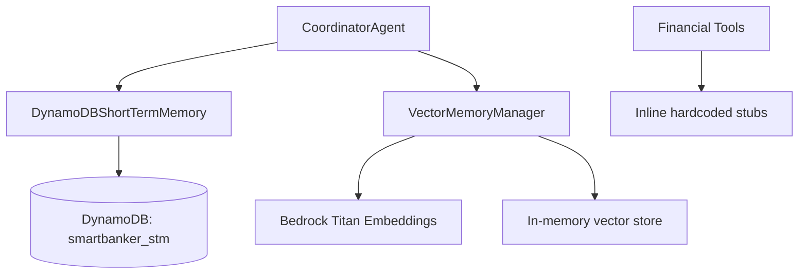
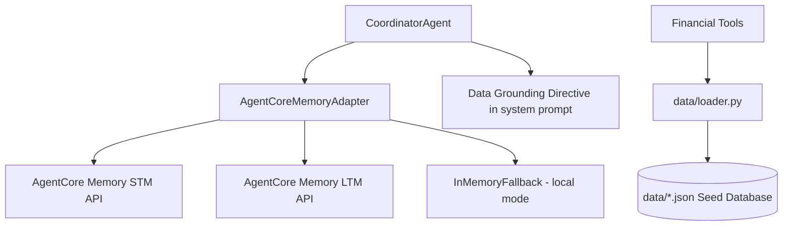

# Design Document: Realistic Data & AgentCore Memory Migration

## Overview

This feature addresses two systemic issues in SmartBanker:

1. **Data grounding**: Local tool stubs return minimal hardcoded data (e.g., 7 transactions, fixed balances), causing the LLM to hallucinate financial details. We introduce a comprehensive JSON seed database under `data/` with realistic banking data (customers, accounts, 90+ days of transactions, product catalogs, credit cards, loans, portfolios) and a loader module (`data/loader.py`) that all tool stubs read from.

2. **Memory migration**: The current memory layer uses a raw DynamoDB table (`smartbanker_stm`) for STM and a custom in-memory vector store with Bedrock Titan embeddings for LTM. We migrate both to AgentCore Memory's managed APIs via the Strands Agents SDK, removing the standalone DynamoDB infrastructure and custom cosine similarity implementation.

The design preserves backward compatibility with the existing 160 tests, the `MemoryDegradationControl` interface, and all Pydantic data models.

## Architecture

### Current Architecture



### Target Architecture



### Key Design Decisions

1. **Adapter pattern for memory**: A new `AgentCoreMemoryAdapter` class wraps AgentCore Memory APIs and exposes the same `store_interaction`, `retrieve_interactions`, `get_failures`, `store_pattern`, `search_patterns` interface that `CoordinatorAgent` already uses. This minimizes changes to the coordinator.

2. **In-memory fallback for local mode**: When `USE_LAMBDA=false` or AgentCore Runtime is unavailable, the adapter falls back to an in-memory implementation that mirrors the same API. This keeps local dev and tests working without AWS connectivity.

3. **Seed data as static JSON files**: Data lives in `data/*.json` files loaded once at import time by `data/loader.py`. This is simple, version-controllable, and requires no database for local development.

4. **Loader as single access point**: All tool stubs call `data.loader` functions instead of defining inline data. This ensures consistency across tools and makes the data easy to update.

## Components and Interfaces

### 1. Seed Database (`data/*.json`)

JSON files under `data/`:

| File | Contents |
|------|----------|
| `data/customers.json` | Customer profiles (user_id, name, tier, contact, KYC, opening date) |
| `data/accounts.json` | Account records (checking, savings, investment per customer) |
| `data/transactions.json` | 60+ transactions per customer spanning 90+ days |
| `data/products.json` | Product catalog (credit cards, loans, investments, insurance) |
| `data/credit_cards.json` | Credit card records per customer (masked numbers, limits, offers) |
| `data/loans.json` | Loan records per customer (type, principal, rate, EMI, tenure) |
| `data/portfolios.json` | Investment portfolios per customer (holdings, asset classes) |
| `data/tier_benefits.json` | Tier benefit definitions (basic through ultra-premium) |

### 2. Seed Data Loader (`data/loader.py`)

```python
# Public API
def get_customer(user_id: str) -> dict:
    """Return full customer profile. Raises KeyError if not found."""

def get_accounts(user_id: str) -> list[dict]:
    """Return all account records for user. Raises KeyError if not found."""

def get_transactions(user_id: str, days: int = 30) -> list[dict]:
    """Return transactions filtered to last N days from most recent date.
    Raises KeyError if user not found."""

def get_products(product_type: str) -> list[dict]:
    """Return catalog entries filtered by type (credit_card, loan, investment, insurance)."""

def get_credit_cards(user_id: str) -> list[dict]:
    """Return credit card records with offers. Raises KeyError if not found."""

def get_loans(user_id: str) -> list[dict]:
    """Return active loan records. Raises KeyError if not found."""

def get_investments(user_id: str) -> dict:
    """Return investment portfolio. Raises KeyError if not found."""

def get_tier_benefits(tier: str) -> list[dict]:
    """Return tier benefit definitions for the given tier."""
```

Module-level loading: all JSON files are read and indexed by user_id at import time. Data is cached in module-level dicts.

### 3. AgentCore Memory Adapter (`memory/agentcore_memory.py`)

```python
class AgentCoreMemoryAdapter:
    """Unified adapter for AgentCore Memory STM + LTM.
    
    Falls back to in-memory implementation when AgentCore Runtime
    is unavailable (local mode).
    """
    
    def __init__(self, config: MemoryConfig):
        """Initialize with AgentCore Memory client or in-memory fallback."""
    
    # STM interface (matches DynamoDBShortTermMemory)
    def store_interaction(self, user_id: str, record: InteractionRecord) -> None: ...
    def retrieve_interactions(self, user_id: str, limit: int | None = None) -> list[InteractionRecord]: ...
    def get_failures(self, user_id: str, limit: int | None = None) -> list[InteractionRecord]: ...
    
    # LTM interface (matches VectorMemoryManager)
    def store_pattern(self, pattern: FinancialPattern) -> None: ...
    def search_patterns(self, query: str, k: int | None = None, user_id: str | None = None) -> list[SimilarPattern]: ...
```

### 4. In-Memory Fallback (`memory/in_memory_fallback.py`)

```python
class InMemorySTM:
    """In-memory STM for local mode. Mirrors DynamoDB pruning behavior."""
    
    def store_interaction(self, user_id: str, record: InteractionRecord) -> None: ...
    def retrieve_interactions(self, user_id: str, limit: int | None = None) -> list[InteractionRecord]: ...
    def get_failures(self, user_id: str, limit: int | None = None) -> list[InteractionRecord]: ...

class InMemoryLTM:
    """In-memory LTM for local mode. Simple keyword-based similarity."""
    
    def store_pattern(self, pattern: FinancialPattern) -> None: ...
    def search_patterns(self, query: str, k: int | None = None, user_id: str | None = None) -> list[SimilarPattern]: ...
```

### 5. Coordinator Changes (`agents/coordinator.py`)

Minimal changes:
- Replace `self.stm = DynamoDBShortTermMemory(memory_config)` with `self.stm = AgentCoreMemoryAdapter(memory_config)`
- Replace `self.ltm = VectorMemoryManager(config=memory_config)` with the same adapter (STM and LTM are unified in one adapter)
- Add Data Grounding Directive to `COORDINATOR_SYSTEM_PROMPT`
- All method calls (`store_interaction`, `retrieve_interactions`, `get_failures`, `store_pattern`, `search_patterns`) remain identical

### 6. Tool Stub Changes (`tools/financial_tools.py`)

Each `_local` lambda is rewritten to call `data.loader` functions instead of returning inline dicts. Error handling wraps `KeyError` from the loader into a JSON error response.

### 7. Data Grounding Directive

Added to `COORDINATOR_SYSTEM_PROMPT` and all worker agent system prompts:

```
CRITICAL DATA GROUNDING RULE:
- You MUST ONLY present financial data that was returned by tool calls.
- You MUST NOT invent, fabricate, or assume any financial data including credit card offers,
  interest rates, account balances, transaction details, or product terms.
- If a tool does not return the requested data, you MUST state "I don't have that information."
- Every number, rate, balance, and product detail you mention MUST come from a tool response.
```

## Data Models

### Seed Database Schema

**Customer Profile** (`customers.json`):
```json
{
  "user_id": "string",
  "name": "string",
  "tier": "basic | preferred | premium | ultra-premium",
  "email": "string",
  "phone": "string",
  "kyc_status": "verified | pending | expired",
  "account_opening_date": "YYYY-MM-DD",
  "date_of_birth": "YYYY-MM-DD"
}
```

**Account Record** (`accounts.json`):
```json
{
  "account_id": "string",
  "user_id": "string",
  "account_type": "checking | savings | investment",
  "balance": 0.00,
  "currency": "INR",
  "status": "active | dormant | closed",
  "opened_date": "YYYY-MM-DD"
}
```

**Transaction Record** (`transactions.json`):
```json
{
  "transaction_id": "string",
  "user_id": "string",
  "date": "YYYY-MM-DD",
  "category": "string",
  "amount": 0.00,
  "merchant": "string",
  "account_id": "string",
  "type": "debit | credit"
}
```

**Product Catalog** (`products.json`):
```json
{
  "product_id": "string",
  "product_type": "credit_card | loan | investment | insurance",
  "name": "string",
  "description": "string",
  "rates": {},
  "terms": {},
  "fees": {},
  "eligibility": {}
}
```

**Credit Card** (`credit_cards.json`):
```json
{
  "card_id": "string",
  "user_id": "string",
  "card_number_masked": "XXXX-XXXX-XXXX-1234",
  "credit_limit": 0.00,
  "current_balance": 0.00,
  "reward_points": 0,
  "offers": []
}
```

**Loan Record** (`loans.json`):
```json
{
  "loan_id": "string",
  "user_id": "string",
  "loan_type": "personal_loan | auto_loan | property_backed_loan | working_capital_facility",
  "principal": 0.00,
  "interest_rate": 0.00,
  "emi": 0.00,
  "tenure_months": 0,
  "outstanding_balance": 0.00,
  "status": "active | closed"
}
```

**Portfolio** (`portfolios.json`):
```json
{
  "user_id": "string",
  "holdings": [
    {
      "asset_name": "string",
      "quantity": 0,
      "purchase_price": 0.00,
      "current_value": 0.00,
      "asset_class": "equity | fixed_income | balanced | commodity"
    }
  ]
}
```

### Existing Models (Unchanged)

The following Pydantic models in `config/models.py` remain unchanged:
- `InteractionRecord` — STM record with user_id, timestamp, input, output, status, confidence, intent, worker_domain, strategy_used, correlation_id
- `FinancialPattern` — LTM record with pattern_id, user_id, pattern_type, content, embedding, metadata
- `SimilarPattern` — search result with pattern_id, content, similarity_score, metadata
- `MemoryContext` — filtered context with failures, patterns, intent
- `PruneEvent` — pruning audit record

### Config Model Changes

`MemoryConfig` in `config/settings.py` adds optional AgentCore-specific fields:

```python
class MemoryConfig(BaseModel):
    agent_id: str
    aws_region: str = "us-east-1"
    stm_namespace: str = "short-term"
    ltm_namespace: str = "long-term"
    max_interactions: int = 20
    max_failures_in_context: int = 10
    max_patterns_in_context: int = 5
    max_context_age_days: int = 90
    default_k: int = 5
    # New: AgentCore Memory config
    use_agentcore_memory: bool = True
    memory_id: str = ""  # AgentCore Memory resource ID
```


## Correctness Properties

*A property is a characteristic or behavior that should hold true across all valid executions of a system — essentially, a formal statement about what the system should do. Properties serve as the bridge between human-readable specifications and machine-verifiable correctness guarantees.*

### Property 1: Loader user-data ownership

*For any* user-specific loader function (`get_customer`, `get_accounts`, `get_credit_cards`, `get_loans`, `get_investments`) and *for any* valid user_id in the seed database, all returned records SHALL have a `user_id` field matching the requested user_id.

**Validates: Requirements 2.2, 2.4, 2.6, 2.7, 2.8**

### Property 2: Transaction date filtering

*For any* valid user_id and *for any* positive integer `days`, `get_transactions(user_id, days)` SHALL return only transactions whose date falls within the window `[most_recent_date - days, most_recent_date]`, and no transaction within that window SHALL be omitted.

**Validates: Requirements 2.3**

### Property 3: Product type filtering

*For any* product_type value, `get_products(product_type)` SHALL return only products whose `product_type` field matches the requested type, and every product in the catalog matching that type SHALL be included.

**Validates: Requirements 2.5**

### Property 4: Loader KeyError for unknown users

*For any* user_id string that does not exist in the seed database, calling any user-specific loader function (`get_customer`, `get_accounts`, `get_transactions`, `get_credit_cards`, `get_loans`, `get_investments`) SHALL raise a `KeyError` whose message contains the unknown user_id.

**Validates: Requirements 2.9**

### Property 5: Tool stub error response for unknown users

*For any* user_id string not present in the seed database, calling any user-specific tool stub (`transaction_fetcher`, `balance_checker`, `activity_analyzer`) with `USE_LAMBDA=false` SHALL return a JSON string containing `"status": "error"` and a message referencing the unknown user_id.

**Validates: Requirements 3.8**

### Property 6: STM interaction round-trip

*For any* valid `InteractionRecord`, storing it via the memory adapter's `store_interaction` and then retrieving interactions for the same user_id SHALL return a record with all original fields (user_id, input, output, status, confidence, intent, worker_domain, strategy_used, correlation_id) preserved.

**Validates: Requirements 5.4**

### Property 7: STM pruning invariant

*For any* sequence of `InteractionRecord` stores for a single user_id that exceeds `max_interactions`, after all stores complete: (a) the total stored interaction count SHALL be ≤ `max_interactions`, (b) all records with `status="failure"` SHALL be retained, and (c) removed records SHALL be the oldest non-failure records.

**Validates: Requirements 5.5**

### Property 8: LTM pattern round-trip

*For any* valid `FinancialPattern`, storing it via the memory adapter's `store_pattern` and then searching with a query matching the pattern's content SHALL return a result whose `pattern_id`, `content`, and `metadata` fields match the original pattern.

**Validates: Requirements 6.3**

### Property 9: LTM search user filtering and top-K cap

*For any* search query, *for any* user_id filter, and *for any* positive integer K, `search_patterns(query, k=K, user_id=user_id)` SHALL return at most K results, and every returned result SHALL belong to the specified user_id.

**Validates: Requirements 6.4**

### Property 10: Degradation control context bounds

*For any* list of `InteractionRecord` failures and *for any* list of `SimilarPattern` patterns, `MemoryDegradationControl.prepare_context(failures, patterns, intent)` SHALL return a `MemoryContext` where `len(failures) ≤ max_failures_in_context` and `len(patterns) ≤ max_patterns_in_context`.

**Validates: Requirements 8.1**

## Error Handling

### Seed Data Loader Errors

| Scenario | Behavior |
|----------|----------|
| JSON file missing or malformed | `data/loader.py` raises `FileNotFoundError` or `json.JSONDecodeError` at import time — fail fast |
| Unknown user_id | `KeyError` with descriptive message including the user_id |
| Unknown product_type | Returns empty list (no error) |

### Memory Adapter Errors

| Scenario | Behavior |
|----------|----------|
| AgentCore Memory unavailable at init | Log warning, fall back to `InMemorySTM` / `InMemoryLTM` |
| AgentCore Memory API call fails | Catch exception, log warning, return empty list / no-op for stores |
| Coordinator continues with empty context | Existing degradation control handles empty failures/patterns gracefully |

### Tool Stub Errors

| Scenario | Behavior |
|----------|----------|
| Loader raises `KeyError` | Tool stub catches it and returns `{"status": "error", "message": "User {user_id} not found"}` |
| Loader raises unexpected error | Tool stub catches generic `Exception` and returns error JSON |

## Testing Strategy

### Property-Based Tests (Hypothesis)

The project already uses Hypothesis (`.hypothesis/` directory present). Each correctness property maps to a property-based test with minimum 100 iterations.

| Property | Test File | Strategy |
|----------|-----------|----------|
| P1: Loader user-data ownership | `tests/test_loader_properties.py` | Generate random valid user_ids from seed data, call each loader function, assert user_id match |
| P2: Transaction date filtering | `tests/test_loader_properties.py` | Generate random (user_id, days) pairs, verify date window invariant |
| P3: Product type filtering | `tests/test_loader_properties.py` | Generate random product_type from known types, verify filter correctness |
| P4: Loader KeyError | `tests/test_loader_properties.py` | Generate random strings not in seed user_ids, verify KeyError across all functions |
| P5: Tool stub error response | `tests/test_tool_stub_properties.py` | Generate random invalid user_ids, call tool stubs, verify error JSON |
| P6: STM round-trip | `tests/test_memory_properties.py` | Generate random InteractionRecords, store and retrieve, verify field preservation |
| P7: STM pruning invariant | `tests/test_memory_properties.py` | Generate random sequences of InteractionRecords exceeding max, verify pruning rules |
| P8: LTM round-trip | `tests/test_memory_properties.py` | Generate random FinancialPatterns, store and search, verify field preservation |
| P9: LTM search filtering | `tests/test_memory_properties.py` | Generate random (query, user_id, K) tuples, verify result count and user filtering |
| P10: Degradation control bounds | `tests/test_memory_properties.py` | Generate random failure/pattern lists, verify context bounds |

Each test tagged with: `# Feature: realistic-data-agentcore-memory, Property N: <title>`

### Unit Tests (Example-Based)

| Area | Tests |
|------|-------|
| Seed data schema validation | Verify all JSON files have required fields (R1.1–R1.8) |
| Loader import caching | Verify data is loaded and cached at import time (R2.1) |
| Data grounding directive | Verify coordinator and worker prompts contain directive (R4.1–R4.4) |
| Graceful degradation | Verify coordinator handles STM/LTM unavailability (R5.6, R6.5) |
| Local mode fallback | Verify in-memory fallback works without AgentCore Runtime (R8.3) |
| Model compatibility | Verify InteractionRecord and FinancialPattern schemas unchanged (R8.4) |

### Integration Tests

| Area | Tests |
|------|-------|
| Tool stub → loader | Each tool stub returns seed data when USE_LAMBDA=false (R3.1–R3.7) |
| Coordinator → memory adapter | End-to-end flow with mocked AgentCore Memory (R5.1–R5.3, R6.1–R6.2) |

### Smoke Tests

| Area | Tests |
|------|-------|
| CloudFormation cleanup | Verify cfn_template.json has no DynamoDB resources (R7.1–R7.2) |
| Deployment config cleanup | Verify aws_config.json references AgentCore Memory (R7.3–R7.4) |
| MemoryConfig schema | Verify agent_id field retained (R8.2) |
| No hardcoded data | Verify financial_tools.py has no inline financial data (R3.9) |
