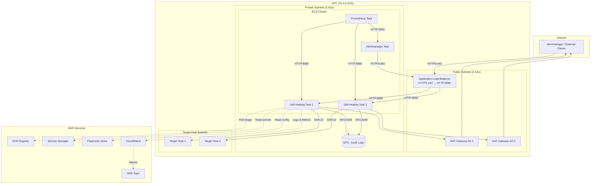

# Design Document: AWS Deployment

## Overview

This design defines the AWS infrastructure for deploying the AIOps Self-Healing Infrastructure application in a production-ready configuration. The deployment uses **AWS CDK (Python)** to provision all resources as Infrastructure as Code, enabling repeatable, version-controlled deployments.

The architecture places the self-healing FastAPI service on ECS Fargate behind an Application Load Balancer, with Prometheus and Alertmanager as companion ECS services. All services run in private subnets within a multi-AZ VPC. Persistent audit logs are stored on EFS, secrets are managed via Secrets Manager, and configuration is injected from Parameter Store. A CI/CD pipeline automates build, test, and rolling deployment with automatic rollback.

### Design Decisions

1. **AWS CDK (Python) over raw CloudFormation**: CDK provides higher-level constructs, type safety, and composability. Python aligns with the existing codebase (FastAPI, Ansible, Hypothesis).
2. **Single CDK App with nested stacks**: Separates concerns (Network, Security, Compute, Monitoring, Pipeline) while allowing cross-stack references via CDK exports.
3. **ECS Fargate over ECS EC2**: Eliminates instance management overhead, aligns with the "no EC2 management" user story.
4. **ALB over NLB**: The service handles HTTP webhooks; ALB provides path-based routing, HTTPS termination, and HTTP→HTTPS redirect natively.
5. **EFS over EBS for audit logs**: EFS supports multi-task concurrent access and survives task replacements. EBS would require single-task attachment.
6. **NAT Gateway per AZ**: Provides redundant outbound connectivity, avoiding single-AZ NAT failure.
7. **Separate ECS services for Prometheus/Alertmanager**: Isolates lifecycle, scaling, and failure domains from the main service.
8. **Rolling deployment with circuit breaker**: ECS deployment circuit breaker provides automatic rollback without custom pipeline logic.

## Architecture



### Deployment Topology

| Component | Service Type | Desired Count | CPU | Memory | AZ Distribution |
|-----------|-------------|---------------|-----|--------|-----------------|
| Self-Healing Service | ECS Fargate | 2 (min) – 10 (max) | 1 vCPU | 2 GB | Spread across 2+ AZs |
| Prometheus | ECS Fargate | 1 | 0.5 vCPU | 1 GB | Single AZ (with EBS/EFS) |
| Alertmanager | ECS Fargate | 1 | 0.25 vCPU | 0.5 GB | Single AZ |

## Components and Interfaces

### CDK Stack Structure

```
cdk_app/
├── app.py                          # CDK App entry point
├── stacks/
│   ├── network_stack.py            # VPC, subnets, NAT, route tables
│   ├── security_stack.py           # IAM roles, security groups, secrets
│   ├── storage_stack.py            # EFS, ECR repository
│   ├── compute_stack.py            # ECS cluster, task definitions, services
│   ├── loadbalancer_stack.py       # ALB, target groups, listeners
│   ├── monitoring_stack.py         # CloudWatch dashboards, alarms, SNS
│   ├── autoscaling_stack.py        # Auto-scaling policies
│   ├── pipeline_stack.py           # CI/CD pipeline (CodePipeline or GitHub Actions)
│   └── prometheus_stack.py         # Prometheus + Alertmanager ECS services
└── constructs/
    ├── fargate_service.py          # Reusable Fargate service construct
    └── secure_efs.py               # EFS with encryption and lifecycle
```

### NetworkStack

```python
class NetworkStack(Stack):
    """VPC with public/private subnets across 2 AZs, NAT Gateways per AZ."""

    def __init__(self, scope, id, **kwargs):
        # VPC: 10.0.0.0/16, 2 AZs
        # Public subnets: ALB, NAT Gateways
        # Private subnets: ECS tasks, EFS
        # NAT Gateway: 1 per AZ for redundancy
        ...

    @property
    def vpc(self) -> ec2.Vpc: ...
    @property
    def private_subnets(self) -> list[ec2.ISubnet]: ...
    @property
    def public_subnets(self) -> list[ec2.ISubnet]: ...
```

### SecurityStack

```python
class SecurityStack(Stack):
    """IAM roles, security groups, and secrets configuration."""

    def __init__(self, scope, id, vpc, **kwargs):
        # Task Execution Role: ECR pull, Secrets Manager read, CloudWatch logs, EFS mount
        # Task Role: Parameter Store read, CloudWatch Metrics write
        # ALB Security Group: inbound 443/80 from 0.0.0.0/0
        # ECS Security Group: inbound 8080 from ALB SG only
        # Target Host SG rule: inbound 22 from ECS SG
        # EFS Security Group: inbound 2049 from ECS SG
        ...

    @property
    def task_execution_role(self) -> iam.Role: ...
    @property
    def task_role(self) -> iam.Role: ...
    @property
    def alb_security_group(self) -> ec2.SecurityGroup: ...
    @property
    def ecs_security_group(self) -> ec2.SecurityGroup: ...
    @property
    def efs_security_group(self) -> ec2.SecurityGroup: ...
```

### StorageStack

```python
class StorageStack(Stack):
    """EFS file system and ECR repository."""

    def __init__(self, scope, id, vpc, efs_security_group, **kwargs):
        # EFS: encrypted at rest (AWS-managed KMS), encryption in transit
        # Lifecycle: transition to IA after 30 days
        # Mount targets in each private subnet
        # ECR: image scanning, lifecycle policy for untagged images
        ...

    @property
    def file_system(self) -> efs.FileSystem: ...
    @property
    def ecr_repository(self) -> ecr.Repository: ...
```

### ComputeStack

```python
class ComputeStack(Stack):
    """ECS cluster, task definitions, and Fargate services."""

    def __init__(self, scope, id, vpc, security_group, task_execution_role,
                 task_role, file_system, ecr_repository, **kwargs):
        # ECS Cluster with container insights enabled
        # Task Definition: 1 vCPU, 2 GB, EFS volume mount at /app/logs
        # Container: image from ECR, port 8080, health check, stop timeout 30s
        # Secrets injection: valueFrom for Secrets Manager references
        # Environment: Parameter Store values as plaintext
        # Service: desired count 2, spread placement, deployment circuit breaker
        ...

    @property
    def service(self) -> ecs.FargateService: ...
    @property
    def task_definition(self) -> ecs.FargateTaskDefinition: ...
```

### LoadBalancerStack

```python
class LoadBalancerStack(Stack):
    """ALB with HTTPS listener, HTTP redirect, and health checks."""

    def __init__(self, scope, id, vpc, alb_security_group, service, **kwargs):
        # ALB: internet-facing, in public subnets
        # HTTPS Listener: port 443, ACM certificate
        # HTTP Listener: port 80, redirect to HTTPS (301)
        # Target Group: port 8080, health check /health (interval 30s, timeout 5s)
        # Healthy threshold: 2, Unhealthy threshold: 3
        ...

    @property
    def alb(self) -> elbv2.ApplicationLoadBalancer: ...
    @property
    def https_listener(self) -> elbv2.ApplicationListener: ...
```

### MonitoringStack

```python
class MonitoringStack(Stack):
    """CloudWatch log groups, alarms, dashboard, and SNS notifications."""

    def __init__(self, scope, id, service, alb, **kwargs):
        # Log Group: 30-day retention
        # Alarm: healthy task count < 2 for 2 periods of 60s
        # Alarm: ALB p95 response time > 5s for 3 periods of 60s
        # Alarm: metrics scrape failure for 3 intervals
        # Dashboard: webhook rate, execution counts, task health
        # SNS Topic: operations notifications
        # Custom metric: PlaybookExecutionFailure
        ...

    @property
    def sns_topic(self) -> sns.Topic: ...
    @property
    def dashboard(self) -> cloudwatch.Dashboard: ...
```

### AutoScalingStack

```python
class AutoScalingStack(Stack):
    """ECS service auto-scaling with asymmetric policies."""

    def __init__(self, scope, id, service, **kwargs):
        # Target: min 2, max 10
        # Scale-out: CPU > 60% for 3 periods → add 2 tasks, cooldown 120s
        # Scale-in: CPU < 30% for 10 periods → remove 1 task, cooldown 120s
        ...
```

### PrometheusStack

```python
class PrometheusStack(Stack):
    """Prometheus and Alertmanager as separate ECS Fargate services."""

    def __init__(self, scope, id, vpc, ecs_cluster, alb_dns, **kwargs):
        # Prometheus: 0.5 vCPU, 1 GB, EFS/EBS for TSDB (50 GB, 15-day retention)
        # Alertmanager: 0.25 vCPU, 0.5 GB
        # Security groups: Prometheus→ECS:8080, Prometheus→AM:9093, AM→ALB:443
        # Health checks: /-/healthy on respective ports
        ...
```

### PipelineStack

```python
class PipelineStack(Stack):
    """CI/CD pipeline: build, test, push, deploy, smoke test, rollback."""

    def __init__(self, scope, id, ecr_repository, service, alb_dns, **kwargs):
        # Source: GitHub main branch trigger
        # Build: Docker build, unit tests, property tests (15 min timeout)
        # Push: tag with git commit SHA
        # Deploy: rolling update, min healthy 100%, max 200%
        # Smoke test: POST /webhook, expect 200 within 10s (3 retries)
        # Rollback: on health check failure or smoke test failure
        ...
```

## Data Models

### CDK Configuration (cdk.json context)

```json
{
  "app": "python app.py",
  "context": {
    "environment": "production",
    "account": "123456789012",
    "region": "us-east-1",
    "vpc_cidr": "10.0.0.0/16",
    "service_name": "aiops-self-healing",
    "container_port": 8080,
    "desired_count": 2,
    "min_capacity": 2,
    "max_capacity": 10,
    "cpu": 1024,
    "memory_mib": 2048,
    "health_check_path": "/health",
    "efs_mount_path": "/app/logs",
    "log_retention_days": 30,
    "efs_lifecycle_days": 30,
    "efs_retention_days": 90,
    "prometheus_retention_days": 15,
    "prometheus_storage_gb": 50,
    "certificate_arn": "arn:aws:acm:us-east-1:123456789012:certificate/xxx",
    "domain_name": "self-healing.example.com",
    "alert_email": "ops-team@example.com"
  }
}
```

### ECS Task Definition Model

```python
@dataclass
class TaskConfig:
    """Configuration for the self-healing ECS task definition."""
    cpu: int = 1024                    # 1 vCPU
    memory_mib: int = 2048             # 2 GB
    container_port: int = 8080
    stop_timeout_seconds: int = 30
    health_check_path: str = "/health"
    health_check_interval: int = 10
    health_check_retries: int = 3
    efs_mount_path: str = "/app/logs"
    image_tag: str = "latest"

@dataclass
class ServiceConfig:
    """Configuration for the ECS Fargate service."""
    desired_count: int = 2
    min_capacity: int = 2
    max_capacity: int = 10
    deployment_min_healthy_percent: int = 100
    deployment_max_percent: int = 200
    placement_strategy: str = "spread"  # spread across AZs
    enable_circuit_breaker: bool = True
    circuit_breaker_rollback: bool = True
```

### Secrets and Parameters Model

```python
@dataclass
class SecretConfig:
    """Secrets stored in AWS Secrets Manager."""
    slack_webhook_url: str       # Secret ARN
    ssh_private_keys: str        # Secret ARN (JSON with key material)
    smtp_credentials: str        # Secret ARN (JSON: host, port, user, password)
    pagerduty_api_token: str     # Secret ARN

@dataclass
class ParameterConfig:
    """Parameters stored in SSM Parameter Store."""
    asset_inventory_path: str = "/app/config/asset_inventory.yml"
    mapping_config_path: str = "/app/config/playbook_mapping.yml"
    audit_log_path: str = "/app/logs/audit.log"
    port: int = 8080
    log_level: str = "INFO"
    service_version: str = "1.0.0"
```

### Auto-Scaling Policy Model

```python
@dataclass
class ScalingPolicy:
    """Auto-scaling configuration."""
    scale_out_cpu_threshold: float = 60.0
    scale_out_evaluation_periods: int = 3
    scale_out_adjustment: int = 2
    scale_out_cooldown_seconds: int = 120

    scale_in_cpu_threshold: float = 30.0
    scale_in_evaluation_periods: int = 10
    scale_in_adjustment: int = -1
    scale_in_cooldown_seconds: int = 120
```

### CloudWatch Alarm Model

```python
@dataclass
class AlarmConfig:
    """CloudWatch alarm definitions."""
    healthy_task_alarm: dict = field(default_factory=lambda: {
        "metric": "HealthyHostCount",
        "threshold": 2,
        "comparison": "LessThan",
        "evaluation_periods": 2,
        "period_seconds": 60,
    })
    latency_alarm: dict = field(default_factory=lambda: {
        "metric": "TargetResponseTime",
        "statistic": "p95",
        "threshold": 5.0,
        "comparison": "GreaterThan",
        "evaluation_periods": 3,
        "period_seconds": 60,
    })
    scrape_failure_alarm: dict = field(default_factory=lambda: {
        "metric": "MetricsScrapeFailure",
        "threshold": 1,
        "comparison": "GreaterThanOrEqual",
        "evaluation_periods": 3,
        "period_seconds": 60,
    })
```

## Error Handling

### Deployment Failures

| Failure Scenario | Behavior | Recovery |
|---|---|---|
| CDK synthesis fails | Pipeline aborts at build stage | Fix CDK code, re-trigger pipeline |
| CloudFormation stack creation fails | Automatic rollback to previous state | Review events, fix resource conflicts |
| ECS task fails to start (secret retrieval) | Task marked STOPPED, reason logged | Verify Secrets Manager permissions and secret existence |
| ECS task fails health check post-deploy | Deployment circuit breaker triggers rollback | Investigate container logs, fix application |
| EFS mount failure at task start | Task fails to reach RUNNING state | Verify EFS security group and mount target availability |
| ALB target group has no healthy targets | ALB returns 503 | Auto-scaling or manual intervention to restore tasks |
| NAT Gateway failure (single AZ) | Tasks in affected AZ lose outbound | Redundant NAT in other AZ handles traffic; ECS reschedules |
| SSH key retrieval failure | Task logs error, rejects remediation requests | Verify Secrets Manager access, rotate if needed |

### Graceful Degradation

- **Partial AZ failure**: ECS spreads tasks across AZs; surviving tasks continue serving.
- **Secrets Manager unavailable at startup**: Task fails fast, ECS replaces it. Already-running tasks continue.
- **Parameter Store unavailable at startup**: Task fails fast. Running tasks unaffected.
- **EFS unavailable during execution**: Task logs to stdout, aborts remediation, sends notification.
- **CloudWatch unavailable**: Logs buffer locally; metrics emission retries with exponential backoff.

### Rollback Strategy

1. **ECS Deployment Circuit Breaker**: If new tasks fail health checks during rolling deployment, ECS automatically rolls back to the previous task definition.
2. **CI/CD Pipeline Rollback**: If smoke test fails post-deployment, pipeline triggers explicit rollback to previous task definition revision.
3. **CloudFormation Stack Rollback**: If infrastructure changes fail, CloudFormation rolls back the entire stack to its previous state.
4. **Manual Rollback**: Operators can force a new deployment with a known-good image tag via `aws ecs update-service --force-new-deployment`.

### Security Incident Response

- **Compromised SSH key**: Rotate secret in Secrets Manager → force new ECS deployment → new tasks pick up rotated key within 5 minutes.
- **Unauthorized access detected**: Security group rules deny by default; CloudTrail logs all IAM actions; alarms trigger on unexpected API calls.

## Correctness Properties

*This feature is Infrastructure as Code (IaC) — it provisions AWS resources using CDK/CloudFormation. Traditional property-based testing with randomized inputs is not applicable because IaC is declarative configuration with deterministic outputs. Instead, correctness is verified through template assertions, compliance checks, and integration tests.*

### Property 1: Network Isolation Invariant

*For all* ECS tasks deployed by the ComputeStack, the tasks SHALL have no public IP addresses assigned and SHALL be placed exclusively in private subnets — verifiable by asserting `AssignPublicIp: DISABLED` in the synthesized CloudFormation template.

**Validates: Requirement 2.2**

### Property 2: IAM Least-Privilege Invariant

*For all* IAM policy statements in the synthesized CloudFormation template, no statement SHALL contain `Resource: "*"` — every policy statement SHALL scope permissions to specific resource ARNs.

**Validates: Requirements 3.1, 3.2, 3.7**

### Property 3: Encryption-at-Rest Invariant

*For all* EFS file systems provisioned by the StorageStack, the `Encrypted` property SHALL be `true` and a KMS key SHALL be associated.

**Validates: Requirement 7.2**

### Property 4: Multi-AZ Distribution Invariant

*For all* deployments of the self-healing ECS service, tasks SHALL be distributed across at least 2 Availability Zones using the spread placement strategy, ensuring no single AZ hosts all running tasks.

**Validates: Requirements 1.1, 10.1**

### Property 5: Security Group Least-Privilege Invariant

*For all* security group ingress rules attached to ECS tasks, inbound traffic SHALL be permitted only from the ALB security group on port 8080 — no other source or port combination SHALL be allowed.

**Validates: Requirements 3.4, 2.7**

### Property 6: Auto-Scaling Boundary Invariant

*For all* scaling events, the resulting task count SHALL remain within the bounds [min_capacity=2, max_capacity=10] regardless of the scaling adjustment calculated.

**Validates: Requirement 6.3**

### Property 7: Deployment Rollback Guarantee

*For all* rolling deployments where new tasks fail health checks (3 consecutive failures), the ECS deployment circuit breaker SHALL trigger automatic rollback to the previous task definition revision.

**Validates: Requirements 9.4, 9.6**

## Testing Strategy

### Why Property-Based Testing Does NOT Apply

This feature is **Infrastructure as Code (IaC)** — it provisions AWS resources using CDK/CloudFormation. PBT is not appropriate because:
- IaC is declarative configuration, not functions with variable inputs/outputs
- Resource provisioning is deterministic given the same inputs
- There is no meaningful input space to randomize over
- The "correctness" of infrastructure is verified by snapshot tests, policy checks, and integration tests

### CDK Snapshot Tests (Unit Level)

Verify that synthesized CloudFormation templates match expected structure:

```python
# test_stacks.py
import aws_cdk as cdk
from aws_cdk.assertions import Template, Match

def test_network_stack_creates_vpc_with_two_azs():
    """Verify VPC has 2 AZs with public and private subnets."""
    app = cdk.App()
    stack = NetworkStack(app, "TestNetwork")
    template = Template.from_stack(stack)
    template.resource_count_is("AWS::EC2::VPC", 1)
    template.resource_count_is("AWS::EC2::NatGateway", 2)

def test_security_stack_no_wildcard_resources():
    """Verify IAM policies have no wildcard resource ARNs."""
    # ... assert no Resource: "*" in any policy statement

def test_compute_stack_task_definition():
    """Verify task definition has correct CPU, memory, and EFS mount."""
    # ... assert CPU=1024, Memory=2048, EFS volume config

def test_alb_https_redirect():
    """Verify HTTP listener redirects to HTTPS with 301."""
    # ... assert redirect action on port 80 listener
```

### CDK Policy/Compliance Tests

Validate security and compliance requirements:

```python
def test_no_public_ip_on_ecs_tasks():
    """ECS tasks must not have public IPs (Requirement 2.2)."""

def test_efs_encryption_at_rest():
    """EFS must use KMS encryption (Requirement 7.2)."""

def test_iam_no_wildcard_resources():
    """All IAM policies must scope to specific ARNs (Requirement 3.1, 3.2)."""

def test_security_group_least_privilege():
    """ECS SG only allows inbound from ALB SG on 8080 (Requirement 3.4)."""

def test_alb_security_group_inbound():
    """ALB SG allows 443/80 from 0.0.0.0/0 only (Requirement 2.7)."""

def test_ecs_non_root_user():
    """Container runs as non-root user (Requirement 3.6)."""

def test_log_retention_30_days():
    """CloudWatch log group has 30-day retention (Requirement 5.1)."""

def test_efs_lifecycle_policy():
    """EFS transitions to IA after 30 days (Requirement 7.4)."""
```

### Integration Tests

Validate deployed infrastructure behavior:

```python
def test_alb_health_check_returns_200():
    """ALB health check endpoint returns 200 for healthy service."""

def test_webhook_endpoint_accepts_payload():
    """POST /webhook with valid Alertmanager payload returns 200."""

def test_https_redirect():
    """HTTP request to ALB port 80 returns 301 redirect to HTTPS."""

def test_ecs_task_count_minimum():
    """ECS service maintains minimum 2 running tasks."""

def test_efs_mount_writable():
    """ECS task can write to /app/logs on EFS."""

def test_secrets_injected_at_runtime():
    """Container environment contains expected secret references."""

def test_autoscaling_responds_to_cpu():
    """Scaling policy triggers when CPU exceeds threshold."""
```

### Smoke Tests (Post-Deployment)

```python
def test_smoke_webhook():
    """Send synthetic webhook, verify 200 response within 10s."""

def test_smoke_health():
    """GET /health returns 200 with healthy status."""

def test_smoke_metrics():
    """GET /metrics returns Prometheus text format."""
```

### Test Tooling

| Tool | Purpose |
|------|---------|
| `aws-cdk-lib.assertions` | CDK snapshot and template assertion tests |
| `pytest` | Test runner for all test types |
| `moto` | Mock AWS services for unit tests |
| `boto3` | Integration tests against deployed infrastructure |
| `requests` | HTTP-level smoke tests |
| `cdk-nag` | Security and compliance rule checks on CDK constructs |
