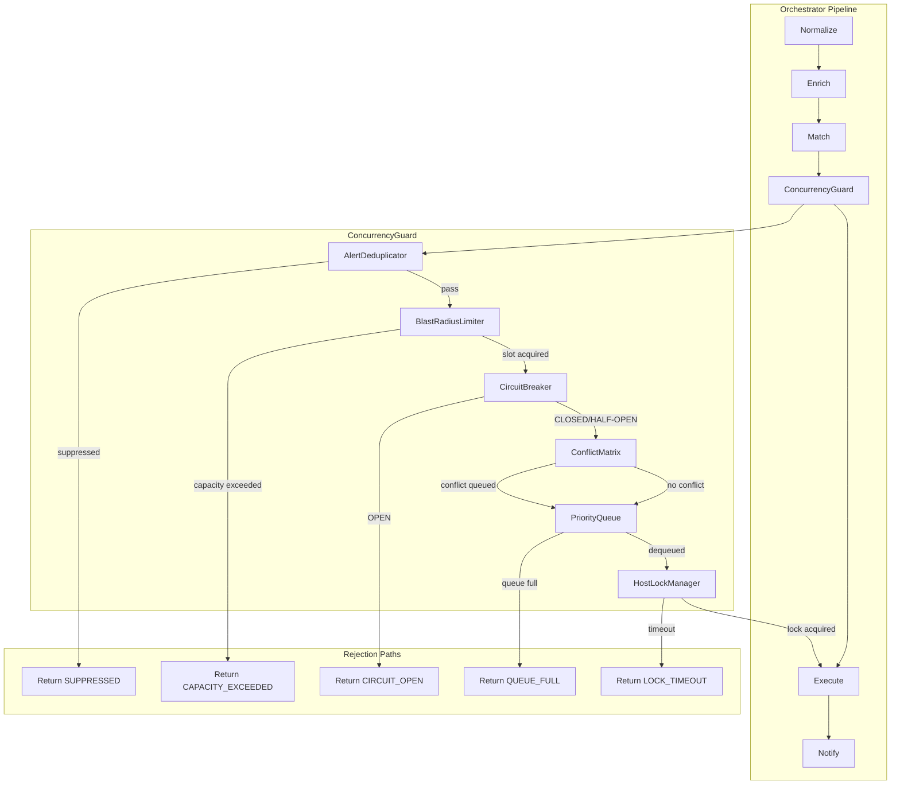

# Design Document: Execution Concurrency Safety

## Overview

This feature introduces a **Concurrency Guard** layer between the orchestrator's match stage and execute stage. The guard coordinates six safety mechanisms—host-level locking, alert deduplication, conflict matrix enforcement, priority-based queuing, per-host circuit breakers, and blast radius limiting—to prevent concurrent Ansible playbook executions from interfering with each other.

The design preserves the existing `RemediationExecutor` interface (`playbook_path`, `target_host`, `extra_vars` → `ExecutionResult`) and wraps it with a `ConcurrencyGuard` facade that the orchestrator calls instead of the executor directly. All new components are pure asyncio-based (no threads), use the existing `Severity` enum for priority ordering, and are configured via YAML files consistent with the existing `config/playbook_mapping.yml` pattern.

### Design Decisions

1. **Facade pattern over executor**: The `ConcurrencyGuard` wraps the existing `RemediationExecutor` rather than modifying it, preserving backward compatibility and testability.
2. **Per-host asyncio.Lock (not Semaphore)**: Each host gets an exclusive `asyncio.Lock` ensuring mutual exclusion. A `dict[str, asyncio.Lock]` is lazily populated.
3. **In-memory state with no external dependencies**: All state (locks, dedup windows, circuit breaker counters, queues) lives in-process. This is appropriate because the system runs as a single FastAPI process.
4. **YAML configuration for conflict matrix**: Follows the existing `playbook_mapping.yml` pattern for operator familiarity.
5. **Priority queue per host**: Each host maintains its own bounded priority queue, enabling independent scheduling without global contention.

## Architecture



### Processing Flow

1. **AlertDeduplicator**: Checks `(hostname, alert_name)` against suppression window. Allows severity escalations through.
2. **BlastRadiusLimiter**: Ensures ≤ N distinct hosts have active remediations. Queues overflow hosts.
3. **CircuitBreaker**: Checks per-host state. Rejects if OPEN, allows probe if HALF-OPEN.
4. **ConflictMatrix**: Checks if any playbook in the same conflict group is running on this host. Queues if conflicting.
5. **PriorityQueue**: Orders pending requests by severity (P1 > P2 > P3), FIFO within same priority.
6. **HostLockManager**: Acquires exclusive per-host lock with configurable timeout (120s default).
7. **Execute**: Delegates to `RemediationExecutor.execute()`.

## Components and Interfaces

### ConcurrencyGuard (Facade)

```python
class ConcurrencyGuard:
    """Facade coordinating all concurrency safety mechanisms."""

    def __init__(
        self,
        executor: RemediationExecutor,
        config: ConcurrencyConfig,
        metrics: MetricsCollector,
    ) -> None: ...

    async def execute(
        self,
        playbook_path: str,
        target_host: str,
        extra_vars: dict | None = None,
        severity: Severity = Severity.P3,
        alert_name: str = "",
        incident_id: str = "",
    ) -> ExecutionResult: ...
```

### HostLockManager

```python
class HostLockManager:
    """Manages per-host asyncio locks with configurable acquisition timeout."""

    def __init__(self, lock_timeout: float = 120.0) -> None: ...

    async def acquire(self, hostname: str) -> bool:
        """Acquire exclusive lock for hostname. Returns False on timeout."""

    def release(self, hostname: str) -> None:
        """Release the lock for hostname."""

    def is_locked(self, hostname: str) -> bool:
        """Check if a host currently has a lock held."""
```

### AlertDeduplicator

```python
class AlertDeduplicator:
    """Suppresses duplicate alerts within a configurable time window."""

    def __init__(self, suppression_window: float = 300.0) -> None: ...

    def should_suppress(
        self, hostname: str, alert_name: str, severity: Severity
    ) -> bool:
        """Returns True if this alert should be suppressed."""

    def record_execution(
        self, hostname: str, alert_name: str, severity: Severity
    ) -> None:
        """Record that an alert was allowed through (starts suppression window)."""

    def cleanup_expired(self) -> None:
        """Remove expired suppression entries."""
```

### ConflictMatrix

```python
@dataclass
class ConflictGroup:
    """A named group of mutually exclusive playbooks."""
    name: str
    playbooks: list[str]

class ConflictMatrix:
    """Enforces mutual exclusion between conflicting playbooks on the same host."""

    def __init__(self, groups: list[ConflictGroup]) -> None: ...

    @classmethod
    def from_yaml(cls, path: str) -> "ConflictMatrix": ...

    def get_conflicts(self, playbook_path: str) -> set[str]:
        """Return all playbook paths that conflict with the given playbook."""

    def is_conflicting(self, playbook_path: str, active_playbooks: set[str]) -> bool:
        """Check if playbook_path conflicts with any currently active playbook."""

    def to_yaml(self) -> str:
        """Serialize the conflict matrix back to YAML."""
```

### PriorityQueue

```python
@dataclass(order=True)
class ExecutionSlot:
    """A queued execution request ordered by priority then arrival time."""
    priority: int  # 1=P1, 2=P2, 3=P3 (lower = higher priority)
    arrival_time: float
    playbook_path: str = field(compare=False)
    target_host: str = field(compare=False)
    extra_vars: dict = field(compare=False, default_factory=dict)
    future: asyncio.Future = field(compare=False, default=None)

class HostPriorityQueue:
    """Per-host bounded priority queue for execution requests."""

    def __init__(self, max_depth: int = 20) -> None: ...

    async def enqueue(self, slot: ExecutionSlot) -> bool:
        """Enqueue a slot. Returns False if queue is full."""

    async def dequeue(self) -> ExecutionSlot:
        """Dequeue the highest-priority slot (blocks until available)."""

    @property
    def depth(self) -> int:
        """Current queue depth."""

    @property
    def is_full(self) -> bool:
        """Whether the queue has reached max_depth."""
```

### CircuitBreaker

```python
class CircuitState(Enum):
    CLOSED = "closed"
    OPEN = "open"
    HALF_OPEN = "half_open"

class HostCircuitBreaker:
    """Per-host circuit breaker with configurable threshold and recovery."""

    def __init__(
        self,
        failure_threshold: int = 3,
        recovery_period: float = 600.0,
    ) -> None: ...

    def get_state(self, hostname: str) -> CircuitState:
        """Get current circuit state for a host."""

    def record_success(self, hostname: str) -> None:
        """Record a successful execution, resetting failure count."""

    def record_failure(self, hostname: str) -> None:
        """Record a failed execution, potentially tripping the breaker."""

    def can_execute(self, hostname: str) -> tuple[bool, CircuitState]:
        """Check if execution is allowed. Returns (allowed, current_state)."""
```

### BlastRadiusLimiter

```python
class BlastRadiusLimiter:
    """Caps the number of hosts undergoing simultaneous remediation."""

    def __init__(
        self,
        max_concurrent_hosts: int = 5,
        overflow_threshold: int = 50,
    ) -> None: ...

    async def acquire_host_slot(self, hostname: str) -> bool:
        """Acquire a slot for this host. Returns False if overflow exceeded."""

    def release_host_slot(self, hostname: str) -> None:
        """Release the slot when remediation completes for this host."""

    @property
    def active_host_count(self) -> int:
        """Number of hosts currently undergoing remediation."""

    @property
    def queued_host_count(self) -> int:
        """Number of hosts waiting for a slot."""
```

### ConcurrencyConfig

```python
@dataclass
class ConcurrencyConfig:
    """Configuration for all concurrency safety mechanisms."""
    host_lock_timeout: float = 120.0
    suppression_window: float = 300.0
    conflict_matrix_path: str = "config/conflict_matrix.yml"
    priority_queue_max_depth: int = 20
    circuit_breaker_threshold: int = 3
    circuit_breaker_recovery: float = 600.0
    max_concurrent_hosts: int = 5
    blast_radius_overflow: int = 50
```

## Data Models

### New Enums

```python
class GuardRejectionReason(Enum):
    """Reasons the ConcurrencyGuard may reject an execution."""
    SUPPRESSED = "suppressed"
    LOCK_TIMEOUT = "lock_timeout"
    CIRCUIT_OPEN = "circuit_open"
    QUEUE_FULL = "queue_full"
    CAPACITY_EXCEEDED = "capacity_exceeded"
    CONFLICT_TIMEOUT = "conflict_timeout"

class CircuitState(Enum):
    """Circuit breaker states."""
    CLOSED = "closed"
    OPEN = "open"
    HALF_OPEN = "half_open"
```

### New Dataclasses

```python
@dataclass
class SuppressionEntry:
    """Tracks when an alert was last allowed through for deduplication."""
    hostname: str
    alert_name: str
    severity: Severity
    timestamp: float  # time.monotonic()

@dataclass
class CircuitBreakerState:
    """Per-host circuit breaker state."""
    state: CircuitState = CircuitState.CLOSED
    consecutive_failures: int = 0
    last_failure_time: float = 0.0
    opened_at: float = 0.0

@dataclass
class ExecutionSlot:
    """A queued execution request."""
    priority: int  # 1=P1, 2=P2, 3=P3
    arrival_time: float
    playbook_path: str
    target_host: str
    extra_vars: dict
    severity: Severity
    alert_name: str
    incident_id: str
```

### Configuration Schema (config/conflict_matrix.yml)

```yaml
conflict_groups:
  - name: service-restart
    playbooks:
      - playbooks/restart_service.yml
      - playbooks/rolling_restart.yml
  - name: disk-operations
    playbooks:
      - playbooks/clear_disk.yml
      - playbooks/resize_volume.yml
  - name: network-changes
    playbooks:
      - playbooks/reconfigure_network.yml
      - playbooks/failover_network.yml
```

### Configuration Schema (config/concurrency.yml)

```yaml
concurrency:
  host_lock_timeout: 120
  suppression_window: 300
  priority_queue_max_depth: 20
  circuit_breaker:
    failure_threshold: 3
    recovery_period: 600
  blast_radius:
    max_concurrent_hosts: 5
    overflow_threshold: 50
  conflict_matrix_path: config/conflict_matrix.yml
```

### Metrics Extensions

New metrics added to `MetricsCollector`:

| Metric Name | Type | Labels | Description |
|---|---|---|---|
| `guard_lock_acquisitions_total` | counter | hostname | Lock acquisitions |
| `guard_lock_wait_seconds` | histogram | hostname | Lock wait duration |
| `guard_alerts_suppressed_total` | counter | hostname, alert_name | Suppressed alerts |
| `guard_conflict_rejections_total` | counter | hostname, playbook | Conflict rejections |
| `guard_circuit_breaker_trips_total` | counter | hostname | Circuit breaker trips |
| `guard_queue_depth` | gauge | hostname | Current queue depth |
| `guard_active_hosts` | gauge | — | Active remediation hosts |
| `guard_capacity_rejections_total` | counter | — | Capacity exceeded rejections |

## Correctness Properties

*A property is a characteristic or behavior that should hold true across all valid executions of a system—essentially, a formal statement about what the system should do. Properties serve as the bridge between human-readable specifications and machine-verifiable correctness guarantees.*

### Property 1: Host Mutual Exclusion

*For any* host and any set of concurrent execution requests targeting that host, the HostLockManager SHALL ensure that at most one execution is active at any given time—all others are serialized (queued until the lock is released).

**Validates: Requirements 1.1, 1.2**

### Property 2: Host Lock Independence

*For any* two distinct hostnames, acquiring a lock on one host SHALL NOT block or delay lock acquisition on the other host—they execute concurrently and independently.

**Validates: Requirements 1.5**

### Property 3: Lock Acquire/Release Round-Trip

*For any* hostname and any sequence of (acquire, release) operations, the HostLockManager SHALL return to a state equivalent to no lock held—the lock is fully released and available for new acquisitions.

**Validates: Requirements 1.6**

### Property 4: Deduplication Metamorphic Bound

*For any* sequence of alerts within a Suppression_Window targeting the same (hostname, alert_name) pair, the number of executions triggered SHALL be less than or equal to the number of distinct severity escalations plus one.

**Validates: Requirements 2.1, 2.3, 2.6, 2.7**

### Property 5: Severity Escalation Override

*For any* (hostname, alert_name) pair under active suppression, if a new alert arrives with strictly higher severity than the suppressing alert, the AlertDeduplicator SHALL allow it through and reset the suppression window.

**Validates: Requirements 2.5**

### Property 6: Conflict Detection

*For any* playbook that belongs to a ConflictGroup, if another playbook from the same group is currently executing on the same host, the ConflictMatrix SHALL report a conflict (is_conflicting returns True).

**Validates: Requirements 3.2**

### Property 7: Conflict Matrix Configuration Round-Trip

*For any* well-formed conflict matrix YAML configuration, parsing it into an in-memory representation and serializing it back to YAML SHALL produce a configuration equivalent to the original (same groups, same playbook sets).

**Validates: Requirements 3.6**

### Property 8: Priority Queue Ordering Invariant

*For all* sequences of enqueue and dequeue operations on a HostPriorityQueue, dequeued items SHALL always be ordered by (severity descending, arrival_time ascending)—P1 before P2 before P3, and FIFO within the same severity.

**Validates: Requirements 4.1, 4.2, 4.6**

### Property 9: Circuit Breaker Threshold and Rejection

*For any* host, when the consecutive failure count exceeds the configured threshold, the CircuitBreaker SHALL transition to OPEN state, and while OPEN, all execution requests for that host SHALL be rejected.

**Validates: Requirements 5.2, 5.3**

### Property 10: Circuit Breaker Success Reset

*For any* host with a non-zero consecutive failure count (in CLOSED state), recording a successful execution SHALL reset the failure count to zero.

**Validates: Requirements 5.8**

### Property 11: Circuit Breaker Determinism

*For any* sequence of success and failure events applied from CLOSED state, the resulting CircuitBreaker state SHALL be deterministic—replaying the identical sequence always produces the same final state.

**Validates: Requirements 5.10**

### Property 12: Blast Radius Invariant

*For all* states of the BlastRadiusLimiter, the number of hosts with active executions SHALL be less than or equal to the configured maximum concurrent hosts.

**Validates: Requirements 6.1, 6.6**

### Property 13: Blast Radius Distinct Host Counting

*For any* set of execution requests, the BlastRadiusLimiter SHALL count distinct hostnames—a host with multiple queued or active executions counts as one host toward the limit.

**Validates: Requirements 6.3**

## Error Handling

### Rejection Responses

When the ConcurrencyGuard rejects an execution, it returns an `ExecutionResult` with:
- `status = RemediationStatus.FAILURE`
- `return_code = -1`
- `stdout = ""`
- `stderr` = descriptive message including the `GuardRejectionReason`
- `duration_seconds` = time spent waiting (if any)
- `playbook_path` and `target_host` preserved from the request

### Graceful Degradation

| Failure Scenario | Behavior |
|---|---|
| Conflict matrix YAML missing/invalid | Log warning, fall back to host-level locking only |
| Concurrency config YAML missing | Use all defaults (120s lock, 300s suppression, etc.) |
| Lock acquisition timeout | Return LOCK_TIMEOUT result, release any partial state |
| Queue full | Return QUEUE_FULL result immediately (no waiting) |
| Capacity exceeded | Return CAPACITY_EXCEEDED result immediately |
| Circuit breaker OPEN | Return CIRCUIT_OPEN result immediately |
| Internal exception in guard | Log error, attempt execution without guard (fail-open) |

### Cleanup and Resource Management

- **Lock release guarantee**: Use `try/finally` blocks to ensure locks are always released, even on exceptions.
- **Suppression entry expiry**: Background task runs every 60s to clean up expired entries (prevents memory growth).
- **Queue entry timeout**: Queued entries that wait longer than `host_lock_timeout` are automatically failed and removed.
- **Circuit breaker state**: Persisted only in-memory; restarts reset all breakers to CLOSED (safe default).

### Logging

All guard decisions are logged at structured JSON format with fields:
- `incident_id`, `hostname`, `alert_name`, `severity`
- `guard_action`: one of `allowed`, `suppressed`, `queued`, `rejected`
- `rejection_reason`: populated when `guard_action` is `rejected`
- `queue_wait_ms`: populated when request was queued before execution
- `circuit_state`: current circuit breaker state for the host

## Testing Strategy

### Property-Based Tests (Hypothesis)

The project already uses Hypothesis for property-based testing. Each correctness property maps to a dedicated Hypothesis test with minimum 100 iterations.

**Library**: `hypothesis` (already in `pyproject.toml` dev dependencies)

**Configuration**:
```python
from hypothesis import settings, given, strategies as st

@settings(max_examples=100)
```

**Tag format**: Each test includes a docstring comment:
```python
# Feature: execution-concurrency-safety, Property N: <property text>
```

**Property test targets**:
| Property | Test Module | Key Strategy |
|---|---|---|
| 1: Mutual Exclusion | `test_host_lock_properties.py` | Generate concurrent request counts, verify serialization |
| 2: Lock Independence | `test_host_lock_properties.py` | Generate pairs of distinct hostnames |
| 3: Lock Round-Trip | `test_host_lock_properties.py` | Generate acquire/release sequences |
| 4: Dedup Metamorphic | `test_deduplicator_properties.py` | Generate alert sequences with varying severities |
| 5: Severity Escalation | `test_deduplicator_properties.py` | Generate severity pairs (lower, higher) |
| 6: Conflict Detection | `test_conflict_matrix_properties.py` | Generate conflict groups and active sets |
| 7: Conflict Round-Trip | `test_conflict_matrix_properties.py` | Generate valid YAML configs |
| 8: Queue Ordering | `test_priority_queue_properties.py` | Generate mixed-severity slot sequences |
| 9: CB Threshold | `test_circuit_breaker_properties.py` | Generate failure counts above threshold |
| 10: CB Success Reset | `test_circuit_breaker_properties.py` | Generate failure sequences + success |
| 11: CB Determinism | `test_circuit_breaker_properties.py` | Generate event sequences, replay twice |
| 12: Blast Radius Invariant | `test_blast_radius_properties.py` | Generate acquire/release sequences |
| 13: Distinct Host Count | `test_blast_radius_properties.py` | Generate multi-execution-per-host scenarios |

### Unit Tests (pytest)

Unit tests cover specific examples, edge cases, and integration points:

- **Edge cases**: Lock timeout, queue overflow, capacity exceeded, invalid config fallback
- **State transitions**: Circuit breaker CLOSED→OPEN→HALF-OPEN→CLOSED cycle
- **Integration**: Orchestrator correctly calls ConcurrencyGuard, rejection triggers notification
- **Configuration**: YAML loading, default values, validation

### Integration Tests

- End-to-end pipeline with ConcurrencyGuard in place
- Concurrent alert processing verifying no host conflicts
- Circuit breaker recovery after simulated failures
- Blast radius limiting under simulated alert storm

