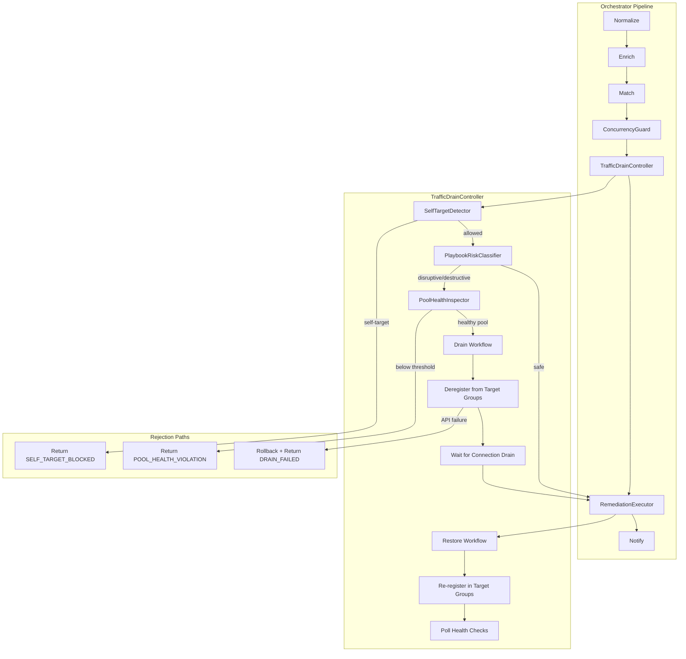

# Design Document: Traffic-Safe Remediation

## Overview

This feature introduces a **Traffic Drain Controller** layer between the ConcurrencyGuard and RemediationExecutor in the orchestrator pipeline. The controller coordinates four safety mechanisms—playbook risk classification, pre-execution traffic drain, post-execution traffic restoration, service pool health awareness, and self-target protection—to ensure that automated remediations do not cause more harm than the original alert condition by dropping active user connections or reducing service capacity below safe levels.

The design wraps the existing `RemediationExecutor` with a `TrafficDrainController` that conditionally performs AWS ELB deregistration/registration based on playbook risk level. All new components are pure asyncio-based, use boto3 for AWS API calls, and are configured via `config/traffic_safety.yml` consistent with the existing YAML configuration pattern.

### Design Decisions

1. **Controller pattern wrapping executor**: The `TrafficDrainController` wraps the existing `RemediationExecutor` (similar to how `ConcurrencyGuard` wraps it), preserving backward compatibility. The orchestrator calls the controller, which delegates to the executor after drain completes.
2. **Risk classification via playbook mapping extension**: Rather than a separate config file for risk levels, risk levels are added to the existing `config/playbook_mapping.yml` rules. A separate `PlaybookRiskClassifier` reads these annotations.
3. **Fail-safe on AWS API errors**: If deregistration fails partway through multiple target groups, the controller rolls back (re-registers) already-deregistered targets and aborts. If health checks fail, the controller rejects the remediation rather than proceeding blind.
4. **Self-target detection at startup**: The `SelfTargetDetector` resolves the automation host's identity once at startup and caches it, avoiding repeated system calls on every remediation.
5. **Graceful bypass when unconfigured**: If `config/traffic_safety.yml` is missing, the controller is bypassed entirely—the orchestrator falls back to direct executor invocation.
6. **boto3 elbv2 client for AWS integration**: Uses the standard `boto3` async-compatible pattern (run_in_executor for sync boto3 calls) to interact with ALB/NLB target groups.

## Architecture



### Processing Flow

1. **SelfTargetDetector**: Compares target host against automation system's own identity. Blocks if match detected.
2. **PlaybookRiskClassifier**: Determines risk level from playbook mapping config. If `safe`, skips drain and goes directly to executor.
3. **PoolHealthInspector**: For `disruptive`/`destructive` playbooks, queries AWS ELB API to check healthy instance count. Rejects if removing target would breach minimum healthy threshold.
4. **Drain Workflow**: Deregisters host from all associated target groups, waits for connections to drain (up to configured timeout).
5. **Execute**: Delegates to `RemediationExecutor.execute()`.
6. **Restore Workflow**: Re-registers host in target groups, polls health checks until healthy or timeout.

## Components and Interfaces

### TrafficDrainController (Facade)

```python
@dataclass
class TrafficDrainResult:
    """Result of the traffic drain controller workflow."""
    execution_result: ExecutionResult
    drain_outcome: DrainOutcome
    drain_duration_seconds: float
    affected_target_groups: list[str]
    restoration_outcome: RestorationOutcome | None


class TrafficDrainController:
    """Orchestrates traffic-safe remediation by wrapping executor with drain/restore."""

    def __init__(
        self,
        executor: RemediationExecutor,
        config: TrafficSafetyConfig,
        risk_classifier: PlaybookRiskClassifier,
        pool_inspector: PoolHealthInspector,
        self_target_detector: SelfTargetDetector,
        metrics: MetricsCollector,
        elb_client: "botocore.client.ElasticLoadBalancingv2",
    ) -> None: ...

    async def execute(
        self,
        playbook_path: str,
        target_host: str,
        extra_vars: dict | None = None,
        incident_id: str = "",
        service_name: str = "",
    ) -> TrafficDrainResult: ...

    async def _drain_host(
        self,
        target_host: str,
        target_group_arns: list[str],
    ) -> DrainOutcome: ...

    async def _restore_host(
        self,
        target_host: str,
        target_group_arns: list[str],
    ) -> RestorationOutcome: ...
```

### PlaybookRiskClassifier

```python
class RiskLevel(Enum):
    """Playbook risk classification levels."""
    SAFE = "safe"
    DISRUPTIVE = "disruptive"
    DESTRUCTIVE = "destructive"


class PlaybookRiskClassifier:
    """Assigns risk levels to playbooks based on configuration."""

    def __init__(self, mapping_config_path: str = "config/playbook_mapping.yml") -> None: ...

    def classify(self, playbook_path: str) -> RiskLevel:
        """Return the risk level for a playbook. Defaults to SAFE if not configured."""

    def requires_drain(self, playbook_path: str) -> bool:
        """Return True if the playbook requires traffic drain (disruptive or destructive)."""

    @classmethod
    def from_yaml(cls, path: str) -> "PlaybookRiskClassifier": ...
```

### PoolHealthInspector

```python
@dataclass
class PoolHealthStatus:
    """Health status of a target group pool."""
    target_group_arn: str
    total_targets: int
    healthy_targets: int
    unhealthy_targets: int
    target_is_healthy: bool


class PoolHealthInspector:
    """Queries AWS ELB to determine target group health and enforce thresholds."""

    def __init__(
        self,
        elb_client: "botocore.client.ElasticLoadBalancingv2",
        min_healthy_threshold: float | int = 0.5,  # 50% default
        api_timeout: float = 10.0,
    ) -> None: ...

    async def check_pool_health(
        self,
        target_host: str,
        target_group_arns: list[str],
    ) -> list[PoolHealthStatus]: ...

    async def can_drain(
        self,
        target_host: str,
        target_group_arns: list[str],
    ) -> tuple[bool, str]: ...
        """Check if draining target_host is safe. Returns (allowed, reason)."""

    def would_breach_threshold(
        self,
        health_status: PoolHealthStatus,
    ) -> bool:
        """Check if removing one healthy target would breach the threshold."""
```

### SelfTargetDetector

```python
@dataclass
class SystemIdentity:
    """The automation system's own identity."""
    hostname: str
    fqdn: str
    ip_addresses: set[str]  # All IPv4/IPv6 including loopback


class SelfTargetDetector:
    """Detects when a remediation targets the automation host itself."""

    def __init__(self) -> None: ...

    def resolve_identity(self) -> SystemIdentity:
        """Resolve the automation system's own hostname and IP addresses."""

    def is_self_target(self, target_host: str) -> bool:
        """Return True if target_host matches the automation system's identity."""

    @property
    def identity(self) -> SystemIdentity | None:
        """Return the resolved system identity, or None if resolution failed."""

    @property
    def is_resolved(self) -> bool:
        """Return True if identity resolution succeeded."""
```

### TrafficSafetyConfig

```python
@dataclass
class TrafficSafetyConfig:
    """Configuration for traffic safety mechanisms."""
    drain_timeout: int = 30  # seconds, valid range 1-300
    health_check_timeout: int = 60  # seconds, valid range 10-300
    health_check_poll_interval: int = 5  # seconds
    min_healthy_threshold: float | int = 0.5  # 50% or absolute count
    re_register_max_retries: int = 3
    service_target_groups: dict[str, list[str]] = field(default_factory=dict)
    # Maps service_name -> list of target group ARNs

    @classmethod
    def from_yaml(cls, path: str = "config/traffic_safety.yml") -> "TrafficSafetyConfig": ...

    def to_yaml(self) -> str:
        """Serialize configuration back to YAML."""

    def validate(self) -> list[str]:
        """Validate configuration values, return list of warnings for invalid params."""
```

## Data Models

### New Enums

```python
class RiskLevel(Enum):
    """Playbook risk classification levels."""
    SAFE = "safe"
    DISRUPTIVE = "disruptive"
    DESTRUCTIVE = "destructive"


class DrainOutcome(Enum):
    """Outcome of the pre-execution drain workflow."""
    COMPLETED = "completed"          # All connections drained within timeout
    TIMEOUT_EXCEEDED = "timeout_exceeded"  # Drain timeout expired, proceeded anyway
    SKIPPED = "skipped"              # No target groups or safe playbook
    FAILED = "failed"                # API error, remediation aborted


class RestorationOutcome(Enum):
    """Outcome of the post-execution restoration workflow."""
    HEALTHY = "healthy"              # Host re-registered and passed health checks
    INCOMPLETE = "incomplete"        # Re-registered but health check timed out
    FAILED = "failed"                # Re-registration API call failed
    SKIPPED = "skipped"              # No restoration needed (was never drained)


class TrafficRejectionReason(Enum):
    """Reasons the TrafficDrainController may reject a remediation."""
    SELF_TARGET_BLOCKED = "self_target_blocked"
    POOL_HEALTH_VIOLATION = "pool_health_violation"
    DRAIN_FAILED = "drain_failed"
    IDENTITY_UNRESOLVED = "identity_unresolved"
```

### New Dataclasses

```python
@dataclass
class SystemIdentity:
    """The automation system's own identity for self-target detection."""
    hostname: str
    fqdn: str
    ip_addresses: set[str]  # All IPv4/IPv6 including loopback


@dataclass
class PoolHealthStatus:
    """Health status snapshot of a single target group."""
    target_group_arn: str
    total_targets: int
    healthy_targets: int
    unhealthy_targets: int
    target_is_healthy: bool  # Whether the specific target host is healthy


@dataclass
class DrainRecord:
    """Structured log entry for a drain operation."""
    incident_id: str
    target_host: str
    drain_start_time: float
    drain_duration_seconds: float
    drain_outcome: DrainOutcome
    affected_target_group_arns: list[str]


@dataclass
class TrafficDrainResult:
    """Complete result of the traffic drain controller workflow."""
    execution_result: ExecutionResult
    drain_outcome: DrainOutcome
    drain_duration_seconds: float
    affected_target_groups: list[str]
    restoration_outcome: RestorationOutcome | None


@dataclass
class TrafficSafetyConfig:
    """Configuration loaded from config/traffic_safety.yml."""
    drain_timeout: int = 30
    health_check_timeout: int = 60
    health_check_poll_interval: int = 5
    min_healthy_threshold: float | int = 0.5
    re_register_max_retries: int = 3
    service_target_groups: dict[str, list[str]] = field(default_factory=dict)
```

### Configuration Schema (config/traffic_safety.yml)

```yaml
traffic_safety:
  drain_timeout: 30          # seconds (valid: 1-300)
  health_check_timeout: 60   # seconds (valid: 10-300)
  health_check_poll_interval: 5  # seconds
  min_healthy_threshold: "50%"   # percentage or absolute count (e.g., "50%" or "2")
  re_register_max_retries: 3

  service_target_groups:
    web-frontend:
      - arn:aws:elasticloadbalancing:us-east-1:123456789012:targetgroup/web-prod/abcdef1234567890
      - arn:aws:elasticloadbalancing:us-east-1:123456789012:targetgroup/web-canary/fedcba0987654321
    api-service:
      - arn:aws:elasticloadbalancing:us-east-1:123456789012:targetgroup/api-prod/1234567890abcdef
    worker-pool:
      - arn:aws:elasticloadbalancing:us-east-1:123456789012:targetgroup/worker-prod/abcdef0987654321
```

### Extended Playbook Mapping (config/playbook_mapping.yml)

```yaml
rules:
  - name: high-cpu-web
    conditions:
      alert_name: HighCPUUsage
      service_name: web-frontend
    playbook_path: playbooks/restart_service.yml
    risk_level: disruptive          # NEW FIELD
  - name: disk-full
    conditions:
      alert_name: DiskSpaceCritical
    playbook_path: playbooks/clear_disk.yml
    risk_level: safe                # NEW FIELD
  - name: service-down
    conditions:
      alert_name: ServiceDown
    playbook_path: playbooks/restart_service.yml
    risk_level: disruptive          # NEW FIELD
  - name: server-reboot
    conditions:
      alert_name: KernelPanic
    playbook_path: playbooks/reboot_server.yml
    risk_level: destructive         # NEW FIELD
```

### Metrics Extensions

New metrics added to `MetricsCollector`:

| Metric Name | Type | Labels | Description |
|---|---|---|---|
| `traffic_drain_started_total` | counter | service_name, target_host | Drain operations started |
| `traffic_drain_completed_total` | counter | service_name, outcome | Drain operations completed |
| `traffic_drain_timeout_total` | counter | service_name, target_host | Drain timeout exceeded |
| `traffic_drain_duration_seconds` | histogram | service_name | Drain wait duration |
| `traffic_pool_health_rejections_total` | counter | service_name, target_group | Pool health rejections |
| `traffic_self_target_blocks_total` | counter | target_host | Self-target blocks |
| `traffic_restoration_completed_total` | counter | service_name, outcome | Restoration outcomes |
| `traffic_restoration_duration_seconds` | histogram | service_name | Restoration wait duration |

## Correctness Properties

*A property is a characteristic or behavior that should hold true across all valid executions of a system—essentially, a formal statement about what the system should do. Properties serve as the bridge between human-readable specifications and machine-verifiable correctness guarantees.*

### Property 1: Risk Level Classification Domain and Default

*For any* playbook path string, the `PlaybookRiskClassifier.classify()` method SHALL return exactly one of the three valid `RiskLevel` values (SAFE, DISRUPTIVE, DESTRUCTIVE). Furthermore, *for any* playbook path that has no explicit valid risk_level in the configuration (including paths with invalid risk_level values), the classifier SHALL return `RiskLevel.SAFE`.

**Validates: Requirements 1.1, 1.2, 1.7**

### Property 2: Risk Level Determines Drain Invocation

*For any* playbook path and risk level classification, the `TrafficDrainController` SHALL invoke the drain workflow if and only if the risk level is DISRUPTIVE or DESTRUCTIVE. *For any* playbook classified as SAFE, the controller SHALL bypass the drain workflow and delegate directly to the executor.

**Validates: Requirements 1.4, 1.5**

### Property 3: Risk Level Round-Trip

*For any* valid risk level string (any case combination of "safe", "disruptive", "destructive"), parsing it into a `RiskLevel` enum and serializing it back to a string SHALL produce a value that is case-insensitively equal to the original input, normalized to lowercase.

**Validates: Requirements 1.6, 1.8**

### Property 4: Drain Deregisters All Target Groups Before Execution

*For any* set of target group ARNs (1 to N) associated with a target host, when a disruptive or destructive playbook is executed, the `TrafficDrainController` SHALL deregister the host from ALL associated target groups before the `RemediationExecutor.execute()` call begins.

**Validates: Requirements 2.1, 2.10**

### Property 5: No Target Groups Implies Drain Skipped

*For any* target host that is not registered in any target group (empty target group list), the `TrafficDrainController` SHALL skip the drain workflow entirely and proceed directly to playbook execution, recording the drain outcome as SKIPPED.

**Validates: Requirements 2.4**

### Property 6: Partial Deregistration Failure Triggers Rollback

*For any* ordered list of target group ARNs where deregistration fails at position K (0-indexed), the `TrafficDrainController` SHALL re-register the host in all target groups that were successfully deregistered (positions 0 through K-1) and return a failure result without invoking the executor.

**Validates: Requirements 2.5**

### Property 7: Pool Health Threshold Enforcement

*For any* target group with `total_targets` registered instances, `healthy_targets` currently healthy, a configured `min_healthy_threshold`, and a target host health state, the `PoolHealthInspector.would_breach_threshold()` SHALL:
- Return True (reject) if the target is healthy AND `(healthy_targets - 1) < threshold_as_count`
- Return False (allow) if the target is unhealthy AND `healthy_targets >= threshold_as_count`
- Return False (allow) if the target is healthy AND `(healthy_targets - 1) >= threshold_as_count`

When the target host is registered in multiple target groups, the inspector SHALL reject if ANY single target group would breach its threshold.

**Validates: Requirements 4.2, 4.3, 4.9**

### Property 8: Self-Target Detection

*For any* target host string that matches the automation system's identity—whether specified as an IP address matching any bound interface (IPv4/IPv6/loopback), a hostname matching the short hostname or FQDN (case-insensitive), or the literal string "localhost"—the `SelfTargetDetector.is_self_target()` SHALL return True. *For any* target host string that does NOT match any element of the system identity, it SHALL return False.

**Validates: Requirements 5.1, 5.2, 5.4, 5.5, 5.8**

### Property 9: Restoration Always Attempted After Drain

*For any* execution result (SUCCESS, FAILURE, or TIMEOUT) where the drain workflow was performed (host was deregistered from target groups), the `TrafficDrainController` SHALL attempt to re-register the host in all previously deregistered target groups, regardless of the execution outcome.

**Validates: Requirements 3.1, 3.5**

### Property 10: Extra Vars Passthrough Preservation

*For any* dictionary of extra variables passed to `TrafficDrainController.execute()`, the controller SHALL pass the identical dictionary (same keys and values, unmodified) to `RemediationExecutor.execute()`.

**Validates: Requirements 7.3**

### Property 11: Configuration Round-Trip

*For any* valid `TrafficSafetyConfig` instance (with drain_timeout in [1,300], health_check_timeout in [10,300], valid threshold, and valid ARN entries), serializing it to YAML and parsing it back SHALL produce a semantically equivalent configuration where all parameter values are preserved.

**Validates: Requirements 6.7**

### Property 12: Configuration Parameter Range Validation

*For any* integer value for `drain_timeout`, values in [1,300] SHALL be accepted as-is, and values outside this range SHALL cause fallback to the default of 30. *For any* integer value for `health_check_timeout`, values in [10,300] SHALL be accepted, and values outside SHALL cause fallback to 60. *For any* threshold value, valid formats (percentage 1-100 or absolute count ≥1) SHALL be accepted, and invalid values SHALL cause fallback to 50%.

**Validates: Requirements 2.8, 2.9, 6.4, 6.5, 6.6**

### Property 13: Target Group ARN Format Validation

*For any* string in the service_target_groups configuration, only strings matching the AWS ARN pattern `arn:aws:elasticloadbalancing:*` SHALL be included in the loaded configuration. Strings not matching this pattern SHALL be excluded.

**Validates: Requirements 6.9**

### Property 14: Rejection Dispatches Notification

*For any* `TrafficRejectionReason` (SELF_TARGET_BLOCKED, POOL_HEALTH_VIOLATION, DRAIN_FAILED, IDENTITY_UNRESOLVED), when the `TrafficDrainController` rejects a remediation, the orchestrator SHALL dispatch a notification containing the rejection reason and target host.

**Validates: Requirements 7.2**

## Error Handling

### Rejection Responses

When the `TrafficDrainController` rejects a remediation, it returns a `TrafficDrainResult` with:
- `execution_result`: An `ExecutionResult` with `status = RemediationStatus.FAILURE`, `return_code = -1`, `stderr` containing the `TrafficRejectionReason` and descriptive message
- `drain_outcome`: `DrainOutcome.FAILED` or `DrainOutcome.SKIPPED`
- `drain_duration_seconds`: Time spent before rejection
- `affected_target_groups`: List of target group ARNs involved
- `restoration_outcome`: None (no restoration needed for rejections)

### Graceful Degradation

| Failure Scenario | Behavior |
|---|---|
| `config/traffic_safety.yml` missing | Bypass TrafficDrainController entirely, execute directly |
| Invalid YAML in config file | Log warning, use all defaults |
| Individual parameter out of range | Log warning for that parameter, use its default |
| Invalid target group ARN format | Log warning, exclude that entry, keep valid entries |
| AWS deregister API failure (partial) | Rollback already-deregistered targets, abort remediation |
| AWS describe-target-health failure | Reject remediation (fail-safe) |
| AWS register API failure (after retries) | Log error, dispatch notification, mark as manual intervention |
| Self-target identity resolution failure | Block ALL remediations until resolved |
| Unexpected exception in controller | Log error, abort remediation, dispatch notification |

### Rollback Guarantees

- **Deregistration rollback**: If deregistration fails partway through multiple target groups, all successfully deregistered targets are re-registered before returning failure. Uses `try/finally` to ensure rollback even on exceptions.
- **Restoration guarantee**: After any execution (success or failure), if drain was performed, restoration is always attempted. Uses `try/finally` around the executor call.
- **Re-registration retries**: Up to 3 attempts with exponential backoff (1s, 2s, 4s) before declaring failure.

### Logging

All traffic safety decisions are logged in structured JSON format with fields:
- `incident_id`, `target_host`, `service_name`, `playbook_path`
- `risk_level`: The classified risk level
- `traffic_action`: one of `drain_started`, `drain_completed`, `drain_timeout`, `drain_skipped`, `drain_failed`, `restore_started`, `restore_completed`, `restore_failed`, `self_target_blocked`, `pool_health_rejected`
- `drain_duration_seconds`: Time spent in drain workflow
- `affected_target_groups`: List of target group ARNs
- `pool_health`: Current healthy/total counts (when applicable)
- `rejection_reason`: Populated when action is a rejection

## Testing Strategy

### Property-Based Tests (Hypothesis)

The project already uses Hypothesis for property-based testing. Each correctness property maps to a dedicated Hypothesis test with minimum 100 iterations.

**Library**: `hypothesis` (already in dev dependencies)

**Configuration**:
```python
from hypothesis import settings, given, strategies as st

@settings(max_examples=100, deadline=5000)
```

**Tag format**: Each test includes a docstring comment:
```python
# Feature: traffic-safe-remediation, Property N: <property text>
```

**Property test targets**:

| Property | Test Module | Key Strategy |
|---|---|---|
| 1: Risk Level Domain & Default | `test_risk_classifier_properties.py` | Generate random playbook paths, verify SAFE default; generate invalid risk strings |
| 2: Risk Level Determines Drain | `test_drain_controller_properties.py` | Generate (playbook, risk_level) pairs, verify drain invocation matches risk |
| 3: Risk Level Round-Trip | `test_risk_classifier_properties.py` | Generate valid risk strings with random casing, verify parse/serialize round-trip |
| 4: Drain All Target Groups | `test_drain_controller_properties.py` | Generate lists of 1-10 target group ARNs, verify all deregistered before execute |
| 5: No TGs → Drain Skipped | `test_drain_controller_properties.py` | Generate hosts with empty TG lists, verify SKIPPED outcome |
| 6: Partial Failure Rollback | `test_drain_controller_properties.py` | Generate TG lists with failure at random position K, verify rollback of 0..K-1 |
| 7: Pool Health Threshold | `test_pool_health_properties.py` | Generate (total, healthy, threshold, target_healthy) tuples, verify decision |
| 8: Self-Target Detection | `test_self_target_properties.py` | Generate IPs, hostnames, case variations; verify detection against known identity |
| 9: Restoration After Drain | `test_drain_controller_properties.py` | Generate execution results (success/failure/timeout), verify restoration attempted |
| 10: Extra Vars Passthrough | `test_drain_controller_properties.py` | Generate arbitrary extra_vars dicts, verify executor receives identical dict |
| 11: Config Round-Trip | `test_config_properties.py` | Generate valid TrafficSafetyConfig instances, verify YAML round-trip |
| 12: Config Range Validation | `test_config_properties.py` | Generate integers for each param, verify acceptance/rejection per range |
| 13: ARN Format Validation | `test_config_properties.py` | Generate strings (valid ARNs and random strings), verify filtering |
| 14: Rejection Notification | `test_drain_controller_properties.py` | Generate rejection reasons, verify notification dispatched with reason |

### Unit Tests (pytest)

Unit tests cover specific examples, edge cases, and integration points:

- **Edge cases**: Drain timeout expiry, health check timeout, re-registration retry exhaustion
- **AWS API mocking**: boto3 elbv2 client responses for deregister/register/describe-target-health
- **Configuration**: Missing file defaults, invalid YAML handling, boundary values (1, 300, 200 entries)
- **Pipeline integration**: Orchestrator correctly calls TrafficDrainController after ConcurrencyGuard
- **Self-target**: Identity resolution failure blocks all, "localhost" detection, IPv6 addresses
- **Restoration**: Successful health check polling, incomplete restoration logging

### Integration Tests

- End-to-end pipeline with TrafficDrainController in place (mocked AWS APIs)
- Concurrent remediations verifying pool health is checked independently per target group
- Full drain → execute → restore cycle with simulated health check transitions
- Bypass behavior when config file is absent
- Interaction with ConcurrencyGuard (drain controller respects guard decisions)

